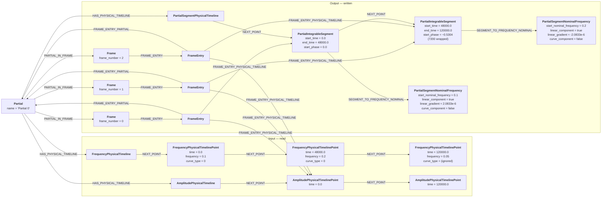
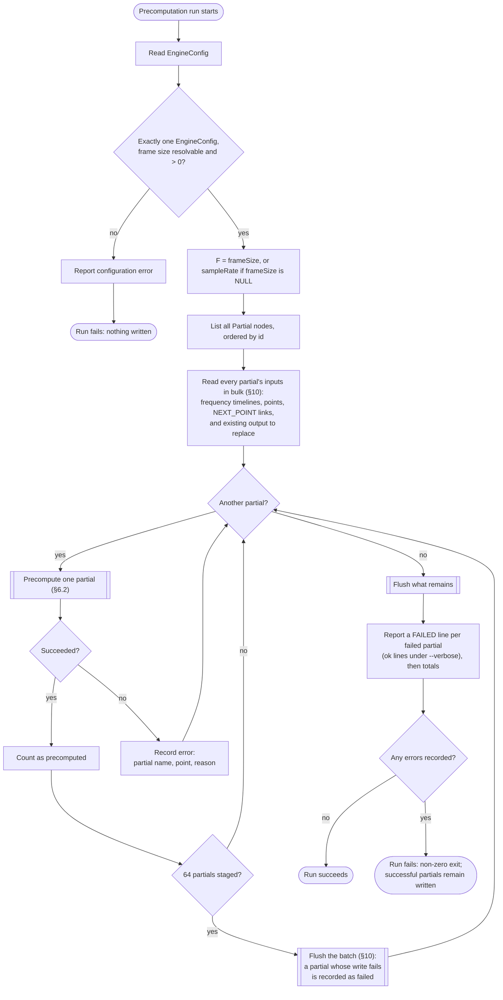
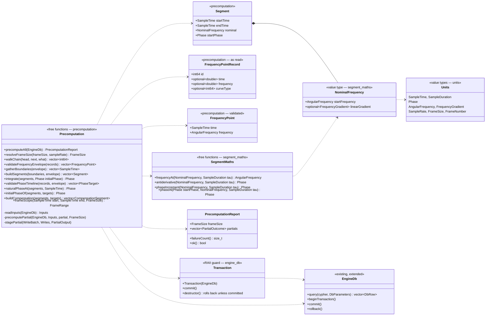

# rendering-engine — precomputation design

**Status:** implemented, for the first version (§2), including the frame
entries of §6.7 and the amplitude reading they need (§4), which were designed
on 2026-09-24 for rendering and implemented on 2026-09-25, and phase control
(§6.8), designed with the author and implemented on 2026-10-03. Spatial
entries (§6.7) were added on 2026-10-04: each frame entry also leads into the
partial's SoundSource's azimuth, elevation and distance timelines. The code is
[units.hpp](../include/rainbohz/rendering_engine/units.hpp),
[segment_maths.hpp](../include/rainbohz/rendering_engine/segment_maths.hpp),
[precomputation.hpp](../include/rainbohz/rendering_engine/precomputation.hpp) and
[precomputation.cpp](../src/precomputation.cpp).

This document designs responsibility 5 of [design.md](design.md) §1 —
"precompute phase integration over integrable segments" — for the first
version of the engine. It operates on `engine-db` as declared in
[engine-schema.cypher](../../engine-db/schema/engine-schema.cypher).

---

## 1. Purpose

Generating audio happens in two steps:

1. **Precomputation** — determine, for every partial, the state it is in at
   the start of every integrable segment of its lifeline, and the phase
   compensation that makes it meet the phase targets of its phase timeline.
   The output is a `PartialSegmentPhysicalTimeline` per partial, plus the
   frames each partial is audible in.
2. **Rendering** — produce the samples of a frame for each channel. Covered by
   a later document.

The point of precomputation is **random access**. Once each segment carries
the phase at its start, the renderer can drop into any frame, find the segment
covering it, and compute the exact phase at any point inside it with one small
closed-form integration, without having rendered anything before it. This is
what lets any frame be rendered in isolation (design.md §2).

## 2. Scope of this version

The engine is being built up one feature at a time. This version handles the
core frequency envelope and phase control.

| In this version | Not yet |
| --- | --- |
| One `FrequencyPhysicalTimeline` per partial, linear curves only | Curve types other than linear (step, accelerate, decelerate, s-curve) |
| One `PhasePhysicalTimeline` per partial: the initial phase, phase targets and free-running points (§6.8) | Frequency modulators (`PartialSegmentFrequencyModulator`) |
| `PartialSegmentPhysicalTimeline`, `PartialIntegrableSegment`, `PartialSegmentNominalFrequency`, `PartialPhaseCompensationSegment` | Entries into modulator lists |
| `PARTIAL_IN_FRAME`, and the `Frame` nodes it needs | Dirty flags and incremental recomputation |
| `FrameEntry` nodes into the segment, amplitude and compensation lists (§6.7) | Spatial position, distance delay, Doppler |
| Rebuild on every run | |

Everything in the right-hand column is anticipated by the structure in §6, but
none of it is implemented, and none of it is validated against: a score that
contains, for example, a `FrequencyModulatorPhysicalTimeline` is precomputed
as though it did not.

## 3. Units and types

Units are those of the rendering model (schema header, "Units and limits").
They are unusual for a reason: they make rendering cheap.

| Quantity | Unit | C++ type (§3.1) | Representation | Type in `engine-db` |
| --- | --- | --- | --- | --- |
| Time, absolute | samples, continuous | `SampleTime` | `double` | `DOUBLE` |
| Time, offset or length | samples, continuous | `SampleDuration` | `double` | `DOUBLE` (as a difference of two times) |
| Frequency | radians per sample | `AngularFrequency` | `double` | `DOUBLE` |
| Frequency gradient | radians per sample² | `FrequencyGradient` | `double` | `DOUBLE` |
| Phase | radians, **local to a segment** | `Phase` | `double` | `DOUBLE` |
| Sample rate | samples per second | `SampleRate` | `std::int32_t` | `INT32` |
| Frame size | samples, discrete | `FrameSize` | `std::int32_t` | `INT32` |
| Frame number | index, discrete | `FrameNumber` | `std::int32_t` | `INT32` |

**Time is continuous even though its unit is the sample.** A point may fall
between samples. This matters later, when Doppler shift means source time is
consumed at a varying rate relative to receiver time (schema header, section
2). Nothing in precomputation rounds a time to a whole sample.

**Frequency in radians per sample** makes the phase increment of one sample at
constant frequency *f* simply *f*. It is sample-rate independent once
converted, which is the transform stage's job (design.md §1, responsibility 3).

**Phase is local to a segment** (author, 2026-10-11). `start_phase` is the
accumulated phase reduced to `[−π, π]` at the segment's start; within the
segment, phase is that start plus what the segment gains, which is not
reduced. So the size of any phase value depends on one segment's frequency
and length, not on how long the piece has run, and so does its precision
(§8). Unwrapped phase exists only transiently, inside a segment.
Frequency is unbounded in both directions, so a segment may gain negative
phase.

### 3.1 Unit types in C++

Every quantity in the table above has its own C++ type, following the
project-wide convention in AGENTS.md (C++ Conventions). Each is a struct with
one member of the listed representation. It is constructed explicitly, read
back with `.value()`, and never converts implicitly to or from its
representation or another unit type. A plain alias
(`using FrameNumber = std::int32_t`) is not enough: it documents intent, but
the compiler treats it as its underlying type, so it would still accept a
`FrameSize` where a `FrameNumber` belongs.

The types allow only the operations that make physical sense. Anything else
does not compile:

| Operation | Result | Why it exists |
| --- | --- | --- |
| `SampleTime − SampleTime` | `SampleDuration` | Segment length Δt; local time τ = t − bᵢ |
| `SampleTime ± SampleDuration` | `SampleTime` | A position within a segment |
| `SampleDuration ± SampleDuration` | `SampleDuration` | |
| `SampleDuration × double`, `SampleDuration / SampleDuration` | `SampleDuration`, `double` | Scaling; ratios |
| `Phase ± Phase` | `Phase` | Accumulation |
| `AngularFrequency ± AngularFrequency`, `AngularFrequency × double` | `AngularFrequency` | Interpolating f₀ (§6.4) |
| `AngularFrequency × SampleDuration` | `Phase` | The f₀·τ term |
| `FrequencyGradient × SampleDuration` | `AngularFrequency` | The g·τ term; ½·(g·τ)·τ is then a `Phase` |
| `AngularFrequency / SampleDuration` | `FrequencyGradient` | A piece's gradient (f₁ − f₀)/(t₁ − t₀) |
| `frameContaining(SampleTime, FrameSize)` | `optional<FrameNumber>` | Frame scope (§6.6): ⌊t / F⌋ |
| `lastFrameBefore(SampleTime, FrameSize)` | `optional<FrameNumber>` | Frame scope (§6.6): ⌈t / F⌉ − 1 |
| `frameStart(FrameNumber, FrameSize)` | `SampleTime` | Frame scope (§6.6) |
| `FrameSize::oneSecond(SampleRate)` | `FrameSize` | The default when `frameSize` is `NULL` |
| Comparison within a type | `bool` | Ordering, Δt > 0 |

**What this rules out:**

- **`SampleTime + SampleTime`.** Two absolute times cannot be added, just as
  with `std::chrono`'s `time_point`. This is the distinction between absolute
  time and local time.
- **Evaluating a segment in absolute time.** The segment functions take their
  position as a `SampleDuration` τ, so the rule in §6.5 that Φ is evaluated in
  local time is enforced by the compiler. Code that passes a `SampleTime` does
  not compile.
- **Mixing frame numbers with frame sizes.** They are both `std::int32_t` in
  the database, and in C++ they cannot be exchanged or combined by arithmetic.
  They meet only in `frameContaining`, `lastFrameBefore` and `frameStart`,
  which return nothing rather than a frame number that does not fit `INT32`.
- **Precision loss by type.** Every quantity integrated into phase is
  represented as `double`, so there is no narrowing conversion anywhere on the
  path from the database to the accumulator for a type to guard (§8).

**Where unwrapping is allowed.** Mixed-unit arithmetic with no natural result
type would unwrap with `.value()`, compute in `double`, and wrap the result,
inside `segment_maths` or the segment-building stage, where the few places the
compiler cannot check units are easy to find. This version needs none: every
term of the linear integration has a unit type, as the table shows. Curve
components, with their sines, will be the first to need it.

**Boundaries.** `EngineDb` reads and writes raw `DOUBLE` and `INT32`
values; precomputation wraps them as soon as it reads them and unwraps them
only to write them back. Ladybug never sees a unit type. When rendering
arrives, its SIMD kernels will work on raw arrays in Structure-of-Arrays
layout. Unit types belong at function interfaces, not inside vectorised inner
loops.

The types cost nothing at run time. A one-member struct with inline operators
compiles to the same code as its representation.

## 4. Inputs

The physical timelines below are normally the transform's output
([transform.md](transform.md) §5), written from a score in musical time just
before precomputation runs; a score written directly in physical time, as the
first two examples are, provides them as they stand.

Precomputation reads, for each partial:

- its one `FrequencyPhysicalTimeline` (`HAS_PHYSICAL_TIMELINE`, `ONE_ONE`), and
- that timeline's `FrequencyPhysicalTimelinePoint`s, in the order of the `NEXT_POINT`
  linked list starting at the timeline node.

For the frame entries of §6.7 it also reads each partial's one
`AmplitudePhysicalTimeline` and its `AmplitudePhysicalTimelinePoint`s in `NEXT_POINT` order,
using `time` only; the amplitude values and curve fields are rendering's
concern (rendering.md §8), but the list is validated whole here (§7),
because this is where the lists are walked.

For phase control (§6.8) it reads each partial's one `PhasePhysicalTimeline`
and its `PhasePhysicalTimelinePoint`s in `NEXT_POINT` order, using `time` and
`phase`. `phase` is in wrapped radians, and `NULL` is a value, not an
absence: it means "free-running up to here". Every partial must have this
timeline, with at least one point, at the start of its lifeline (author,
2026-10-03); the compiler is expected to guarantee it, and precomputation
checks it (§7).

For the spatial entries of §6.7 it reads each partial's SoundSource, through
its set (`HAS_PARTIAL`, `HAS_PARTIALSET`), and that source's one
`AzimuthPhysicalTimeline`, `ElevationPhysicalTimeline` and
`DistancePhysicalTimeline` with their points in `NEXT_POINT` order. It uses
`time`, the value (`azimuth`, `elevation` or `distance`) and the curve type.
The values are rendering's concern (rendering.md §8.5), but the lists are
validated here (§7), because this is where they are walked. A source's
timelines are shared by all its partials, so they are walked and checked
once per run per source, and the result is shared.

It also reads the singleton `EngineConfig`, for the frame size:

- `frameSize`, if not `NULL`;
- otherwise `sampleRate`, so that a frame is one second long.

Of each `FrequencyPhysicalTimelinePoint` it uses `time`, `frequency` and
`frequency_curve_type`. The curve on point *n* describes the path from point
*n* to point *n+1*, so the last point's curve fields have no effect and are
not checked. `frequency_curve_amount` has no effect on a linear curve and is
not read.

## 5. Outputs

For each partial, precomputation writes:

- one `PartialSegmentPhysicalTimeline`, attached by `HAS_PHYSICAL_TIMELINE`;
- a chain of `PartialIntegrableSegment`, linked by `NEXT_POINT` from the
  timeline node, in time order;
- one `PartialSegmentNominalFrequency` per segment, attached by
  `SEGMENT_TO_FREQUENCY_NOMINAL`;
- a chain of `PartialPhaseCompensationSegment`, linked by `NEXT_POINT` from
  the same timeline node, in time order, covering the same lifeline (§6.8);
- one `PARTIAL_IN_FRAME` edge to every `Frame` whose time range overlaps
  the partial's life, creating any `Frame` node that does not yet exist;
- for each of those frames, one `FrameEntry` node, joined to the frame by
  `FRAME_ENTRY`, to the partial by `FRAME_ENTRY_PARTIAL`, and by
  `FRAME_ENTRY_PHYSICAL_TIMELINE` to the `PartialIntegrableSegment`, the
  `AmplitudePhysicalTimelinePoint` and the `PartialPhaseCompensationSegment`
  that the frame's rendering starts from, and to the
  `AzimuthPhysicalTimelinePoint`, `ElevationPhysicalTimelinePoint` and
  `DistancePhysicalTimelinePoint` of its SoundSource that do the same (§6.7).
  The spatial timelines themselves are inputs and are never written.

The shape, for the worked example of §12 (three frequency points, two
segments, three frames), with an amplitude timeline of two points added so
that the frame entries can be shown. Its phase timeline, one point of phase 0
at the start, and the one flat compensation segment it gives, are left out
of the drawing for space; every entry leads to that segment too. So are the
source's spatial timelines, into which every entry also leads:



Frame 1 starts at 48,000, inside segment 1, so its entry leads there; every
frame's amplitude entry is the point at 0, because the only other point is
at the partial's end. The amplitude timeline is read, not written.

In every `PartialSegmentNominalFrequency` written by this version,
`curve_component` is `false` and `curve_start_phase`, `curve_frequency` and
`curve_scaling_factor` are `NULL`: absent, not zero.

N frequency points produce **N − 1 segments**. The last point marks the end of
the partial; it does not start a segment. The phase at that end point is not
stored anywhere, because nothing needs it: a renderer wanting it integrates the
last segment.

## 6. Algorithm

### 6.1 The run

Partials are precomputed one at a time, and each partial's output is staged
as one unit of a write batch, which writes 64 partials at a time (§10).
Partials are independent (design.md §2), so the order does not matter for
correctness; they are taken in `Partial.id` order only so that the report is
deterministic.

A failure in one partial is recorded and the run moves on. A failure in
reading `EngineConfig` is fatal, because no partial can be precomputed without
a frame size.



### 6.2 One partial

The work for one partial is in five stages, separated so that stages 2 to 5
and the frame-scope calculation are pure functions over in-memory data. Only
stage 1 and the write touch the database.

1. **Read** the partial's inputs. The database is read once, in bulk, for all
   partials before the first is processed (§10); this stage picks out one
   partial's share and walks its lists.
2. **Gather boundaries** — the sorted, distinct set of times at which any
   input changes.
3. **Build segments** — one segment between each consecutive pair of
   boundaries, each with its nominal frequency parameters.
4. **Integrate** — walk the segments in order with the phase accumulator,
   from the initial phase φ₀ (§6.8).
5. **Compensate and stage** — build the phase compensation segments (§6.8),
   then stage everything as one unit of the write batch, which writes it
   whole or not at all (§10).

```mermaid
flowchart TD
    start(["Partial P"]) --> read["<b>Stage 1 — read</b><br/>From the bulk read: walk P's FrequencyPhysicalTimeline<br/>point list in NEXT_POINT order"]
    read --> valid{"Inputs valid?<br/>(checks in §7)"}
    valid -- no --> err

    valid -- yes --> bounds["<b>Stage 2 — gather boundaries</b><br/>B = sorted distinct times from every input<br/>(this version: frequency point times only)"]

    bounds --> build["<b>Stage 3 — build segments</b><br/>for i = 0 .. |B| − 2:<br/>segment i covers [bᵢ, bᵢ₊₁)"]
    build --> nominal["Derive NominalFrequency of segment i<br/>from the envelope piece covering bᵢ (§6.4)"]
    nominal --> moreSeg{"More segments?"}
    moreSeg -- yes --> nominal

    moreSeg -- no --> init["<b>Stage 4 — integrate</b><br/>φ = wrap(φ₀) (double; §6.8)<br/>i = 0"]
    init --> assign["segment i: start_phase = φ"]
    assign --> integ["φ = φ + phaseIncrement(nominal i, Δtᵢ)<br/>using exactly the values that will be stored (§6.5)"]
    integ --> finite{"φ finite?"}
    finite -- no --> err
    finite -- yes --> reduce["φ = wrap(φ) to [−π, π]:<br/>local to the next segment"] --> next{"More segments?"}
    next -- yes --> step["i = i + 1"] --> assign

    next -- no --> comp["<b>Stage 5 — compensate</b><br/>PartialPhaseCompensationSegments<br/>from the phase timeline (§6.8)"]
    comp --> scope["Frame scope of P (§6.6)<br/>k from ⌊b₀ / F⌋ to ⌈b_last / F⌉ − 1"]
    scope --> scopeOk{"Frame numbers fit INT32?"}
    scopeOk -- no --> err

    scopeOk -- yes --> begin["Begin a unit of the write batch"]
    begin --> del["Stage deletes, by id, of P's existing PartialSegmentPhysicalTimeline,<br/>its segments, their nominal frequencies, its compensation segments,<br/>its FrameEntry nodes, and P's PARTIAL_IN_FRAME edges"]
    del --> write["Stage PartialSegmentPhysicalTimeline, segments,<br/>NEXT_POINT chains, nominal frequencies, compensation segments"]
    write --> frames["Stage missing Frame nodes<br/>and PARTIAL_IN_FRAME edges"]
    frames --> entries["Stage FrameEntry nodes and their edges (§6.7)"]
    entries --> done(["Staged; written when the batch flushes,<br/>whole or not at all"])

    err(["Failure: record partial, point, reason;<br/>nothing written for P"])
```



A partial that fails is left with **nothing** written, not a partial result:
every check that can fail runs before anything is staged, and a database
failure while the batch writes is confined to the partial's unit (§10). A
partial that failed on a previous run and fails again keeps whatever the
previous successful run wrote, because its deletions are staged with its
writes and are never written without them. With rebuild-every-run this is
harmless; it will matter once dirty flags exist (§13).

### 6.3 Gathering boundaries

A boundary is any time at which some input to the partial's frequency
changes how it behaves. Soon there will be two sources:

- the main frequency envelope — the time of every `FrequencyPhysicalTimelinePoint`;
- frequency modulators — the times of their timeline points.

Phase points are **not** a source. The phase compensation segments of §6.8
are a list of their own, with boundaries unrelated to the integrable
segments' (author, 2026-10-03); rendering merges the two (rendering.md
§6.4.1).

The boundaries from all sources are merged into one sorted set of distinct
times. Consecutive boundaries define the segments, so the segments form a
contiguous sequence with no gaps and no overlaps, from the partial's first
frequency point to its last.

In this version there is one source, so the boundary set is exactly the
frequency point times. The merge step is still written as a merge, so adding a
source means adding its times and nothing else.

The partial's life is `[b₀, b_last)`: the first and last frequency points.
Boundaries from other sources that fall outside this range will be discarded
when those sources exist; this version has none.

### 6.4 Building segments

For segment *i*, covering `[bᵢ, bᵢ₊₁)`, find the envelope piece *j* that
covers its start: the frequency points *j* and *j+1* with
`t_j ≤ bᵢ < t_{j+1}`. Then:

```math
g_j = \frac{f_{j+1} - f_j}{t_{j+1} - t_j}
\qquad
f_0 = f_j + g_j\,(b_i - t_j)
```

where *f₀* is the segment's `start_nominal_frequency` and *g_j* its
`linear_gradient`. Arithmetic is in `double` throughout (§8).

When `bᵢ = t_j` — which in this version is always the case — `f₀` is the
point's stored frequency, taken directly rather than computed. Only a boundary
from another source, falling strictly inside an envelope piece, needs the
interpolation. Such a segment continues its piece with the same gradient.

`linear_component` is always `true` in this version, even when the gradient is
zero. A flat segment is linear with gradient zero; the flag records that the
component is present, not that it is non-trivial.

### 6.5 Integration

Within segment *i*, time is measured locally, from the segment's start:
`τ = t − bᵢ`, with `τ ∈ [0, Δtᵢ)` and `Δtᵢ = bᵢ₊₁ − bᵢ`. The segment's nominal
frequency is a sum of components; in this version only the linear one:

```math
f_i(\tau) = f_0 + g\,\tau
```

The phase is the integral of the frequency. It is computed through the
**antiderivative** Φ of the segment's frequency, which is the sum of the
antiderivatives of its components:

```math
\Phi_i(\tau) = f_0\,\tau + \tfrac{1}{2}\,g\,\tau^2
```

```math
\varphi(b_i + \tau) = \varphi_i + \Phi_i(\tau) - \Phi_i(0)
\qquad
\varphi_{i+1} = \varphi_i + \Phi_i(\Delta t_i) - \Phi_i(0)
\qquad
\varphi_0 = \text{the initial phase (§6.8)}
```

where φᵢ is segment *i*'s `start_phase`. For the linear component Φ(0) = 0,
but the subtraction is part of the definition: components added later need not
have that property.

This is an exact integration of the continuous envelope, not a sum over
samples, and it is written as an integration rather than as the linear-case
formula on purpose:

- **It generalises.** Curves and frequency modulators each contribute an
  antiderivative term to Φ. The accumulator loop in §6.2 does not change.
- **It is shared with rendering.** The renderer needs the phase at arbitrary,
  non-sample-aligned points inside a segment (schema header, section 1). It
  calls the same `phaseAt` function with the same stored parameters, so the
  phase precomputation writes at a boundary is exactly the phase the renderer
  would compute there.

**Local time, always.** Φ is evaluated in τ, never in absolute time *t*. With
*t* in the hundreds of millions of samples, a term like `g·t²` would cancel
catastrophically; `g·τ²` over one segment does not.

### 6.6 Frame scope

A frame *k* covers `[k·F, (k+1)·F)`, where *F* is the frame size. The
partial's life is `[b₀, b_last)`. The frames that overlap it are:

```math
k_{\text{first}} = \left\lfloor \frac{b_0}{F} \right\rfloor
\qquad
k_{\text{last}} = \left\lceil \frac{b_{\text{last}}}{F} \right\rceil - 1
```

The half-open ranges make the edges come out right: a partial ending exactly
at `k·F` is not in frame *k*.

The partial gets one `PARTIAL_IN_FRAME` edge to each frame from
`k_first` to `k_last` inclusive. `Frame` nodes are shared between partials, so
they are created if missing (`MERGE` on `frame_number`) and are never deleted
by precomputation, even on rebuild. An unreferenced `Frame` node is harmless.

This is source time. With no spatial position there is no propagation delay,
so source time and receiver time coincide and the calculation is exact. When
distance arrives, a partial's receiver-time life is later than its source-time
life, and frame scope will be computed from the delayed times: the two
Doppler calculations, at the start and at the end of the lifeline, are
accepted as precomputation's cost (schema, `PARTIAL_IN_FRAME`), so scope
stays exact rather than conservative.

### 6.7 Frame entries

A partial's segments and amplitude points are reachable only through their
lists, from the head (AGENTS.md, Linked Lists). Rendering frame *k* needs the
segment and the amplitude piece covering the frame's first sample, and
walking to them from the head costs the length of the list, which grows with
the score. So precomputation records, for every frame the partial is in
scope for, where that frame's rendering starts (decided 2026-09-24):

```math
t^*_k = \max(b_0,\ k \cdot F)
```

- the **entry segment** is the segment with `start_time ≤ t*_k < end_time`;
- the **entry point** is the last `AmplitudePhysicalTimelinePoint` with
  `time ≤ t*_k`, the start of the amplitude piece covering `t*_k`;
- the **entry compensation segment** is the `PartialPhaseCompensationSegment`
  with `start_time ≤ t*_k < end_time`, by the same rule as the entry segment;
- the **spatial entry points** are, on each of the partial's SoundSource's
  three spatial timelines, chosen by the frame's start `k·F` rather than by
  `t*_k` (author, 2026-10-05): the point exactly at `k·F` if there is one;
  otherwise the last point before it; otherwise the first point, which then
  lies inside the frame. That is: the last point with `time ≤ k·F`, or the
  first point if none is.

All of them exist for every frame in scope, because `t*_k ∈ [b₀, b_last)` there,
the amplitude timeline's first and last times equal `b₀` and `b_last` (§7),
and both segment lists cover `[b₀, b_last)` exactly. A spatial timeline that
starts inside the frame starts at or before the earliest `b₀` of its source's
partials, which coverage guarantees (§7), so its first point is never too
late for any of them.

The spatial entries depend on the frame and the source, not the partial, so
every partial of a source leads to the same three points in a frame. The
renderer may then process from the frame's start even where a partial
starts later; it tracks the position sample by sample over the whole frame
anyway, and a smaller, simpler graph is worth more than skipping the silent
start of a frame (author, 2026-10-05).

They are recorded as one **`FrameEntry`** node per partial per frame: a node
with no properties, whose only purpose is to be found from the frame and to
lead to the right places. Three relationship tables join it up:

| Edge | From → to | Multiplicity | Meaning |
| --- | --- | --- | --- |
| `FRAME_ENTRY` | `Frame` → `FrameEntry` | `ONE_MANY` | a frame has one entry per partial in scope; an entry belongs to one frame |
| `FRAME_ENTRY_PARTIAL` | `FrameEntry` → `Partial` | `MANY_ONE` | an entry belongs to one partial; a partial has one per frame |
| `FRAME_ENTRY_PHYSICAL_TIMELINE` | `FrameEntry` → `PartialIntegrableSegment`, `FrameEntry` → `AmplitudePhysicalTimelinePoint`, `FrameEntry` → `PartialPhaseCompensationSegment`, `FrameEntry` → `AzimuthPhysicalTimelinePoint`, `FrameEntry` → `ElevationPhysicalTimelinePoint`, `FrameEntry` → `DistancePhysicalTimelinePoint` | one per pair | an entry leads to one node of each list; a list node is the entry of every frame it spans, and a spatial point of every partial of its source too |

`Frame` is keyed by frame number, so the renderer reaches a frame's entries
in one indexed hop from a primary-key lookup, and from each entry reaches
the partial and all six lists in one hop more. The compensation list is
reached from the same `FrameEntry` as the others, not from one of its own
(author, 2026-10-03). Nothing is filtered on a
property.

The spatial entry points are the same for every partial of a source, so the
same edge is written once per partial. The schema puts them on the
per-partial `FrameEntry` (author, 2026-10-04). Rendering reads them, checks
that a source's partials agree, and walks each source's lists once
(rendering.md §6.3). The node is the graph's way of saying "this partial, in this
frame", and it is the natural home for any per-partial per-frame state a
later version wants to keep, such as the phase at the frame's start
(rendering.md §6.4.1).

`PARTIAL_IN_FRAME` says the same thing as the existence of a `FrameEntry`,
in one hop rather than two. It is kept for now (§14).

All the entries of one partial come from one forward pass over each list,
advancing a cursor as the frame starts increase, so the cost is the length
of the list plus the number of frames, not their product. A source's spatial
lists span all its partials, so their cursors start by binary search at the
start of the partial's first frame, and then move forward the same way. An entry per
partial per frame is one node and eight edges, at the same count as the
scope edges.

**Under Doppler** the source time at a receiver frame's start is not known
without a binary search over the set's distance path, which is deliberately
not done here (schema header, section 2). The rule, settled by the author
in the schema's comment on `FRAME_ENTRY_PHYSICAL_TIMELINE`, is to point as if the
delay were zero — the *latest* source time the frame start can map to — and
have the renderer walk **backward** from it, never forward. The walk is
bounded by the set's distance divided by the speed of sound, and both
directions of `NEXT_POINT` are indexed (AGENTS.md, Bidirectional
Traversal), so the backward walk costs what a forward one would. With no
distance delay the entry is already exact and there is no walk. This
version computes `t*_k` in source time, which is the zero-delay rule.

### 6.8 Phase control

Decided with the author on 2026-10-03; @see ADR 0019
records the decision.

**Phase is a target, not an envelope.** A `PhasePhysicalTimelinePoint`
`{time, phase}` says "at this time, the phase must be this". It does not shape
the phase between points the way a frequency point shapes the frequency; the
frequency envelope does that, and the phase follows from it. To hit a target
the engine works out what the phase *would* be at that time, and adds a
linear adjustment from the previous point up to it. That adjustment is a
small constant change of frequency over the span: the trade-off between
frequency and phase is resolved in favour of phase, and the longer the span,
the smaller the change.

**`NULL` is a point, not an absence.** A point with `phase` `NULL` means
"free-running up to here": no adjustment is made over the span that ends
there. It still starts a new span, so a target after it is met by a ramp over
the shorter span from the `NULL` point, not from the target before. (In the
canonical model a free-running state gives a `NULL` point, and a default
state, which plays no role in phase, gives none: transform.md §6.6.)

**The natural phase.** N(t) is the phase the frequency envelope gives: the
integral of §6.5, from the initial phase φ₀. It is evaluated at a time *t*
by `phaseAt` on the integrable segment covering *t* (`naturalPhaseAt`), the
same computation the renderer makes there, so the two agree to the last bit.

**The initial phase φ₀** lives in the integrable segments: it is the first
segment's `start_phase`, and the accumulator starts from it (author,
2026-10-03). So the integrable segments hold the phase the frequency gives
from the initial condition, and nothing of the compensation.

- If the first point (which is at `b₀`) has a phase, φ₀ is that phase.
- If it is `NULL`, φ₀ is worked **backwards**: the partial runs free from
  `b₀` and meets the first point that has a phase, the *anchor*, exactly:

  ```math
  \varphi_0 = \text{wrap}_{[-\pi,\pi)}\!\left(\theta_k - N_0(t_k)\right)
  ```

  where N₀ is the natural phase integrated from 0. Every span up to the
  anchor is free-running. (Author, 2026-10-03: obscure, but the kind of thing
  the system should allow.)
- If every point is `NULL`, φ₀ is 0.

Because φ₀ can depend on N₀, the segments are integrated twice: from 0, then
from φ₀. What is written is a straight integration from φ₀, exactly as if φ₀
had been known from the start.

**Compensation segments.** A `PartialPhaseCompensationSegment`
`{start_time, end_time, start_phase_delta, end_phase_delta}` is a span over
which the adjustment D ramps linearly from `start_phase_delta` to
`end_phase_delta`. The list is headed by the partial's
`PartialSegmentPhysicalTimeline`, beside the integrable segments, and there
is **always at least one**: the model is easier to write and to understand if
it is always present, and a flat ramp costs the renderer nothing (author,
2026-10-03). Its boundaries are `b₀`, every phase point time strictly inside
`(b₀, b_last)`, and `b_last`; they have no relation to the integrable
segments' boundaries.

**The running adjustment.** D starts at 0 at `b₀`. It is reduced to
`[−π, π]` at the start of every compensation segment, and never inside one
(author, 2026-10-11, replacing the 2026-10-03 rule that D is never wrapped):
each segment's `start_phase_delta` is local, and its `end_phase_delta` is
that start plus the segment's whole rise, which is not reduced, so the
ramp's slope is exact. A segment's `start_phase_delta` may therefore differ
from the previous segment's `end_phase_delta` by a multiple of 2π, which is
the same phase. In time order, for each point after the anchor:

- a point with phase θᵢ at tᵢ moves D by the smallest change that meets it,

  ```math
  D \leftarrow D + \text{wrap}_{[-\pi,\pi)}\!\left(\theta_i - (N(t_i) + D)\right)
  ```

  and the span ending at tᵢ ramps from the old D to the new one;
- a `NULL` point leaves D as it is, so the span ending there is flat.

The anchor and every point before it are already met by φ₀, so their spans
are flat at 0. If the last point is before `b_last`, the span from it to
`b_last` is flat at the final D.

`wrap_[−π,π)` reduces to the half-open range: a change of exactly half a
cycle is −π, never +π (author, 2026-10-03). "Exactly" is taken within
`kHalfCycleTieTolerance`, 1e-9 rad (author, 2026-10-11). A change that is a
half cycle in exact arithmetic, such as targets 180 degrees apart a whole
number of cycles later, comes out a few 1e-13 rad either side of π in
floating point, and which side depends on the order of the arithmetic; the
tolerance makes the rule hold whatever the rounding. It is `wrapHalfOpen` in
`units.hpp`, distinct from the renderer's `wrap`, whose result may be either
end of `[−π, π]`.

**Worked example** (the author's): a constant-frequency partial with phase 0
at 10 s and π at 30 s, which, running free, would be at π/2 at 30 s. The
adjustment needed is +π/2 over 20 s, so D is π/4 at 20 s. With a `NULL` point
added at 20 s, the span `[10 s, 20 s)` is flat and the same π/2 is made up
over `[20 s, 30 s)`, so D is π/4 at 25 s. With the first point `NULL`
instead, φ₀ is π/2 and there is no adjustment at all.

**What rendering does with it** (rendering.md §6.4.1, §7): the phase at *t*
is N(t) + D(t). Compensation segment starts are a further source of render
segment boundaries, and over a render segment D adds a constant slope
`(end_phase_delta − start_phase_delta) / (end_time − start_time)` to the
per-sample phase step. The slope is not part of the nominal frequency, so the
frequency-range roll-off does not see it.

## 7. Validation

Input is checked before anything is written. Validation is also expected
before the database is loaded (by the compiler) and during rendering; this
layer is defensive, and it is the only one that exists while batch-mode scores
are hand-written Cypher. If it proves costly it may later sit behind a flag.

Every failed check names the partial, the point where one is involved, and the
reason.

| Check | Scope | On failure |
| --- | --- | --- |
| Exactly one `EngineConfig` | run | run fails |
| `frameSize`, or `sampleRate` when it is `NULL`, is non-`NULL` and > 0 | run | run fails |
| The partial has a `FrequencyPhysicalTimeline` | partial | partial fails |
| The timeline has at least 2 points | partial | partial fails |
| The `NEXT_POINT` chain has no cycle (a branch is refused by the database) | partial | partial fails |
| Every point's `time` and `frequency` are non-`NULL` and finite | partial | partial fails |
| The first point's `time` is ≥ 0: a partial cannot start before the score does (confirmed by the author, 2026-09-23) | partial | partial fails |
| `time` strictly increases along the list (every Δt > 0) | partial | partial fails |
| Every point except the last has `frequency_curve_type` = 0 (linear) | partial | partial fails |
| Every accumulated phase is finite | partial | partial fails |
| Every frame number fits `INT32` | partial | partial fails |
| The partial has an `AmplitudePhysicalTimeline` with at least 2 points, and the chain has no cycle | partial | partial fails |
| Every amplitude point's `time` is non-`NULL` and finite, and strictly increases along the list | partial | partial fails |
| The first amplitude point's `time` equals the first frequency point's, and the last equals the last, exactly: the two timelines define the lifeline together (author, 2026-09-24) | partial | partial fails |
| The partial has a `PhasePhysicalTimeline` with at least 1 point, and the chain has no cycle | partial | partial fails |
| Every phase point's `time` is non-`NULL` and finite, and strictly increases along the list | partial | partial fails |
| The first phase point's `time` equals the first frequency point's exactly, and no phase point is after the last | partial | partial fails |
| Every phase point's `phase` is `NULL`, or finite and in `[−π, π]` | partial | partial fails |
| The partial's set is aggregated by exactly one `SoundSource` | partial | partial fails |
| The source has one each of `AzimuthPhysicalTimeline`, `ElevationPhysicalTimeline` and `DistancePhysicalTimeline`, each with at least 1 point, and no chain has a cycle | source: every partial of it fails, naming the source | partial fails |
| Every spatial point's `time` and value are non-`NULL` and finite; `time` strictly increases; azimuth is in `[−π, π]`, elevation in `[−π/2, π/2]`, distance in `[1, 16384]` metres; every point except the last has curve type 0 (linear) | source, as above | partial fails |
| Each spatial timeline's first point is at or before the partial's `b₀`: a source's position is defined from the start of every partial of it (author, 2026-10-04). There is no rule for the end: after its last point the value holds (author, 2026-10-05) | partial | partial fails |

Three rules from the schema are **not** checks here:

- Frequency is unbounded in both directions by design, so there is no range
  check on it. Frequencies outside the rendering range are the renderer's
  concern.
- `frequency_curve_amount` has no meaning for a linear curve.
- The last point's curve fields have no meaning at all (§4).

**Linked-list integrity.** `NEXT_POINT` is `ONE_ONE`, but Ladybug counts
multiplicity separately for each FROM/TO pair (AGENTS.md, Linked Lists). So a
point can have one predecessor that is a `FrequencyPhysicalTimeline` and another that
is a `FrequencyPhysicalTimelinePoint`. The database therefore does not rule out:

- **A cycle through the head** — the last point links back to the first.
  Checked: `walkChain` stops at the first node it revisits, and the partial
  fails. Without the check the walk would never end.
- **Merged lists** — one timeline's head is a point in the middle of another
  timeline's list, so two partials share a tail of points. This is an error
  (confirmed by the author, 2026-09-23), but precomputation does **not**
  check it. Each partial would still be precomputed correctly from the points
  it reaches; the harm is that the two envelopes cannot be edited separately.
  `--validate-db` detects it, along with every cycle
  ([integrity.md](integrity.md) §4).

Both are defended by how the database is built: the components upstream build
each list fresh and never link into another. The check here is a backstop for
the case that would otherwise hang, not a guarantee of integrity; that is
what `--validate-db` is for. A
point-to-timeline membership edge, which would let the schema enforce
ownership, has been rejected as overhead on the most numerous nodes in the
database.

## 8. Numerical precision

**Everything integrated into phase is `double`**: time, frequency, frequency
gradient, accumulated phase, phase targets and compensation deltas, and (when
they arrive) curve and frequency modulator parameters. Both in memory and in
`engine-db`.

This was a deliberate choice over storing frequency parameters as `float`,
which would halve their storage. With `float` parameters, precomputation would
have had to integrate the rounded values rather than the ones it computed, or
disagree with the renderer at every segment boundary by roughly `½·δg·Δt²`,
where δg is the gradient's rounding error. For a 480,000-sample glide from 0.1
to 0.2 rad/sample that is of the order of 10⁻³ radians. Every function
producing or consuming a frequency would have had to respect that rounding
point. With `double` throughout there is no narrowing anywhere between the
database and the accumulator, and `engine-db`'s `DOUBLE` round-trips a
`double` exactly.

The rule that remains is one of algorithm, not of type:

> Precomputation and rendering evaluate a segment with the **same
> `segment_maths` functions** on the **same stored parameters**.

That makes the phase precomputation writes at a boundary bit-identical to the
phase the renderer would compute there.

A segment's frequency at its end, `f₀ + g·Δt`, can still differ from the next
segment's `start_nominal_frequency` in the last bit, because the gradient is a
rounded quotient. The step is of the order of 10⁻¹⁷ rad/sample. **Phase
remains exactly continuous**, because each segment's `start_phase` is by
construction the integral of the previous segment's stored parameters,
reduced to `[−π, π]`; `std::remainder` is exact, so the reduction adds no
rounding beyond that of 2π itself.

**Phase is local, so its precision depends on a segment, not a piece**
(author, 2026-10-11). Every `start_phase` is in `[−π, π]`, and the largest
phase value anything computes is what one segment gains over its length,
f·Δt + ½g·Δt². For a segment at 1 kHz lasting an hour at 48 kHz that is about
2.3 × 10⁷ radians, where the spacing of `double` values is about 4 × 10⁻⁹
radians; for a day, about 10⁻⁷. Both are far below anything audible. A piece
of any length is as precise as its longest segment.

**Known limits.** Two cases can still lose precision, and both are accepted:

- *A segment that is very long at a very high frequency.* At the kernel's
  limit of 1000 cycles per sample (rendering.md §7), a segment lasting a day
  at 96 kHz gains about 5 × 10¹³ radians, where the spacing of `double` is
  about 0.008 radians. Such a partial is silenced by the roll-off, so this
  matters only if it comes back into the audio band within the same segment.
  The remedy, if it is ever needed, is to insert extra segment boundaries
  where none is strictly required.
- *Absolute time.* Times are absolute sample positions in `double`. Whole
  samples are exact up to 2⁵³, about 2,970 years at 96 kHz, and at a month
  the spacing of representable times is about 3 × 10⁻⁵ samples. At 639 years
  (John Cage's *ORGAN²/ASLSP* in its Halberstadt performance) it is 0.25
  samples, which is where segment boundaries would start to be placed
  coarsely. This is the next ceiling after phase, far above any realistic
  piece.

A phase correction that is exactly a half cycle is the one place where
rounding could change a result rather than just perturb it; §6.8 describes
the tolerance that removes it.

## 9. Transactions, rebuild and idempotency

**Rebuild every run.** Precomputation deletes and recreates each partial's
output unconditionally. This is intended for batch mode; dirty flags will
replace it (§13).

**Idempotent.** Running precomputation twice on the same graph produces the
same segments, the same parameters and the same phases. Only the `SERIAL` ids
of the recreated nodes differ, so nothing may hold such an id across a run.
This preserves the invariant in design.md §2 that duplicate precomputation is
safe.

**One unit per partial.** A partial's output is either completely present or
completely absent, never half-written, and one partial's failure cannot
affect another's output. The write batch keeps this although it writes 64
partials per transaction: if that transaction fails, it is rolled back and
each partial is written again in a transaction of its own, so the failure is
confined to the partial that caused it (§10; @see ADR 0022).

## 10. Code structure

Four pieces in `rendering-engine`, each depending only on the ones above it
in this list:

1. **`units`** — the unit types of §3.1 and their operations. Header-only, with
   no dependencies. Rendering will use them as well.
2. **`segment_maths`** — the segment's frequency and phase functions. No
   database dependency, no I/O. Shared by precomputation and, later,
   rendering; this is the concrete form of the schema's requirement that "the
   exact same algorithms, maths conventions etc. must be used for
   precomputation and for rendering".
3. **`EngineDb` additions** — typed reading of result rows, parameterised
   statements, and explicit transactions. As now, the public header does not
   expose Ladybug types. It deals in raw representations; wrapping them in unit
   types is the caller's job (§3.1).
4. **`precomputation`** — the algorithm of §6. Stages 2 and 3, integration and
   frame scope are free functions over in-memory data, testable without a
   database; reading and writing are the only functions that take an
   `EngineDb`.



The pure stages are public so that they can be tested without a database;
reading and writing are internal to `precomputation.cpp`. Two decisions are
worth stating:

- **Absent means `std::optional`.** The linear gradient is optional, mirroring
  `linear_component`; curve fields, when curves arrive, will be too, mirroring
  the `NULL`s written to the database, so that "no component" and "a component
  with zero parameters" remain distinct in memory as well. Values as read
  (`FrequencyPointRecord`) are all optional, because every property is
  nullable in the schema; validation turns them into unit types.
- **Errors are exceptions** (AGENTS.md, C++ Conventions). A per-partial
  failure is thrown inside that partial's precomputation, caught by
  `precomputeAll`, and recorded in the report. A configuration failure
  propagates out of `precomputeAll`.

**Wiring.** `loadScore()` (`score_pipeline.cpp`), which batch mode and every
server `PUT /v1/score` call, runs precomputation once the transform has succeeded,
and before any frame is listed. It always runs; there
is no flag to skip it. The census that follows then shows the new rows, which
makes an empty result visible.

**Reading the linked list.** Ladybug refuses a variable-length relationship
pattern with an upper bound over 30 hops ("Upper bound of rel exceeds
maximum: 30", established by experiment), and a timeline can be far longer.
So lists are not matched in one pattern. Instead, before the first partial is
processed, a fixed handful of queries reads every `FrequencyPhysicalTimeline` head,
every `FrequencyPhysicalTimelinePoint`, and every point-to-point `NEXT_POINT` link, and
the same for existing `PartialSegmentPhysicalTimeline`s and their segments. Each
partial's lists are then walked in C++ (`walkChain`), which also detects a list
that loops back on itself. This is cheaper than walking one query per node,
and it keeps every read ahead of every write.

**Writing.** Output goes through a `WriteBatch` (`write_batch.hpp`;
@see ADR 0022), not one statement per node or edge. Executing a statement
costs Ladybug far more than writing one row inside it, so the batch sends
each table's rows as one statement over a list of records. Operations are
registered once per run, one per table or relationship pair. Rows staged
against them are written by `flush()` every 64 partials, in a fixed order:

1. deletes of the earlier run's output, all by id: the `FrameEntry` and
   nominal-frequency ids are read in bulk with the rest of the inputs, so no
   delete finds its nodes through a hop from the partial, except
   `PARTIAL_IN_FRAME`, deleted from the partial, and only for partials that
   had scope before;
2. nodes: `MERGE` on `Frame` for the frames in scope, sent once each, then
   `UNWIND $rows AS r CREATE … RETURN r.k, n.id` per node table, which
   reports the id of each new node by its handle;
3. relationships: `COPY … FROM (UNWIND $rows AS r RETURN r.from, r.to)` per
   relationship pair, which finds both ends by primary-key index; ends staged
   as handles are resolved to the ids from step 2.

So a list is written as one node insert plus one `NEXT_POINT` insert,
however long it is, and nothing waits for an id. The number of statements per
flush depends on the number of tables (28 operations), not on the number of
rows. Nodes come before relationships because node properties never hold
node ids: every reference between rows is a relationship.

Each partial is one unit of the batch. A flush writes all its units in one
transaction. If that fails, the batch rolls back and writes each unit in a
transaction of its own, and a unit that still fails is reported as that
partial's failure, with Ladybug's error text.

**Tests.** `segment_maths` is tested against hand-derived closed-form values:
a constant segment, rising and falling glides, negative frequency, a segment of
fractional length, and splitting a segment without changing its phase. Phase
control is tested on the author's worked examples (§6.8), the back-worked
initial phase, the exact half cycle and a near tie at it, local start
phases and deltas whose rises are kept, and a target at the lifeline's end. The
unit types are tested largely at compile time: each operation that must not
compile is a `static_assert`. Each pure stage of precomputation has its own
tests, and whole runs are tested against the real schema in memory: the
worked example, rebuild idempotency, a failing partial among good ones, and a
timeline longer than 30 points. Test cases over musically meaningful scores
are designed separately.

## 11. What the renderer can rely on

This is the contract precomputation offers rendering, and what the rendering
design will build on:

- Every partial that precomputed successfully has exactly one
  `PartialSegmentPhysicalTimeline`, whose segments are contiguous, in time order,
  non-empty, and cover exactly `[b₀, b_last)`.
- Each segment's phase at local time τ is
  `phaseAt(start_phase, nominal, τ)`, computed from the stored values, and
  agrees with the next segment's `start_phase` at τ = Δt, modulo 2π: every
  `start_phase` is in `[−π, π]`, and so is every compensation segment's
  `start_phase_delta`.
- `PARTIAL_IN_FRAME` lists exactly the frames the partial's life
  overlaps. A frame with no such edge from a partial need not consider it.
- For every such frame there is one `FrameEntry` reachable from the `Frame`
  node, leading to the partial, and to the segment, the amplitude point, the
  compensation segment and the source's azimuth, elevation and distance
  points covering the frame's first instant inside the partial's life
  (§6.7).
  Walking forward from each along `NEXT_POINT` reaches everything the frame
  needs; under Doppler the walk may also go backward, by the same rule.
- The partial's amplitude timeline is well formed: at least two points,
  strictly increasing in time, starting and ending exactly where the
  frequency timeline does. Rendering may rely on this and need not walk
  the list from its head.
- Its compensation segments are contiguous, in time order, non-empty, and
  cover exactly `[b₀, b_last)`. The phase the partial must have at *t* is
  N(t) + D(t), D interpolated linearly over the covering compensation
  segment, and it meets every phase target of the phase timeline (§6.8).
- The partial's SoundSource has one azimuth, one elevation and one distance
  timeline, each well formed, linear, in range, and starting at or before the
  partial's `b₀`.

## 12. Worked example

One partial, frame size *F* = 48,000 (the sample rate, `frameSize` `NULL`),
three linear frequency points — the example drawn in §5.

| Point | time | frequency |
| --- | --- | --- |
| 0 | 0 | 0.1 |
| 1 | 48,000 | 0.2 |
| 2 | 120,000 | 0.05 |

Boundaries: `{0, 48000, 120000}`, so two segments.

**Segment 0**, `[0, 48000)`, Δt = 48,000:

```math
g = \frac{0.2 - 0.1}{48000} \approx 2.0833 \times 10^{-6}
\qquad
\Delta\varphi = 0.1 \cdot 48000 + \tfrac{1}{2} \cdot g \cdot 48000^2 = 4800 + 2400 = 7200
```

**Segment 1**, `[48000, 120000)`, Δt = 72,000:

```math
g = \frac{0.05 - 0.2}{72000} \approx -2.0833 \times 10^{-6}
\qquad
\Delta\varphi = 0.2 \cdot 72000 + \tfrac{1}{2} \cdot g \cdot 72000^2 = 14400 - 5400 = 9000
```

| Segment | start_time | end_time | start_phase | start_nominal_frequency | linear_gradient |
| --- | --- | --- | --- | --- | --- |
| 0 | 0 | 48,000 | 0 | 0.1 | ≈ 2.0833 × 10⁻⁶ |
| 1 | 48,000 | 120,000 | ≈ −0.5304 (7200 − 1146·2π) | 0.2 | ≈ −2.0833 × 10⁻⁶ |

Segment 1's `start_phase` is the running phase, 7200, reduced to `[−π, π]`
(§3). The phase at the partial's end, 16,200 or ≈ 1.9483 wrapped, is not
stored.

Values are shown in exact arithmetic. The stored values can differ in the
last bits, because 0.1, 0.2, 0.05 and the gradients are not exactly
representable in binary. Tests compare with a tolerance of a few units in the
last place, not for exact equality, and compare phases modulo 2π.

Frame scope: `k_first = ⌊0 / 48000⌋ = 0`, `k_last = ⌈120000 / 48000⌉ − 1 =
⌈2.5⌉ − 1 = 2`. Frames 0, 1 and 2.

## 13. Future extensions

In roughly the order they are expected. Each is placed so that it slots into
§6 without restructuring it.

| Extension | Where it goes |
| --- | --- |
| Frequency curve types | A curve component in `NominalFrequency` with its own antiderivative term in Φ; validation relaxes to accept the new `frequency_curve_type` values. |
| Frequency modulators | A second boundary source (§6.3); `PartialSegmentFrequencyModulator` nodes per segment; their antiderivatives join Φ. Frequency modulation is multiplicative, so the integrand becomes a product and Φ is no longer a simple sum — the proof of concept's closed-form method (`proof-of-concept/maths/`) is the reference. |
| Spatial position and delay | Frame scope computed in receiver time from the delayed partial life (§6.6), and frame entries by one of the two rules of §6.7. |
| Modulator entries | A `FrameEntry` per partial set per frame, or further `FRAME_ENTRY_PHYSICAL_TIMELINE` pairs, since modulator lists hang off the set rather than the partial. |
| Dirty flags | Replace rebuild-every-run: only partials whose inputs changed are recomputed. A partial that fails must then not keep stale output (§6.2). |

## 14. Open questions

- **Near-coincident boundaries.** Once there are several boundary sources, two
  may differ by a tiny amount and produce a segment far shorter than a sample.
  Δt > 0 permits it, and it is numerically harmless, but it costs a segment. A
  merge tolerance may be wanted; there is no need to decide until the second
  source exists.
- **Frame node lifetime.** `Frame` nodes are created on demand and never
  deleted (§6.6). If frames later carry per-frame state (rendered object
  references, dirty flags), whether an unreferenced frame should be removed
  needs deciding.
- **`PARTIAL_IN_FRAME` alongside `FrameEntry`.** The scope edge and the
  entry node say the same thing (§6.7). The edge is one hop where the node
  is two, and it is the older, simpler test; the cost is a second set of
  edges at the same count, written and deleted together with the entries.
  Retiring it would leave the entry as the definition of scope.
- **`linear_component` when the gradient is zero.** §6.4 sets it `true`. The
  alternative, `false` for flat segments, would let the renderer skip a term;
  the saving is negligible and the rule would be one more thing to keep
  consistent.
