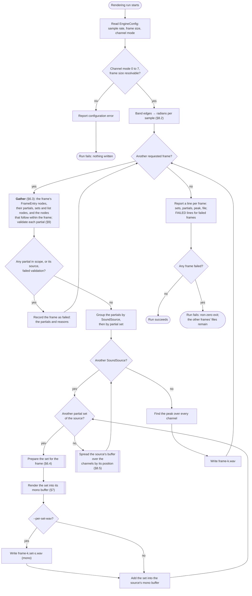

# rendering-engine — rendering design

**Status:** implemented, for the first version (§2). This document is the
agreed design, settled with the author on 2026-09-24; the code followed on
2026-09-25. Phase control (precomputation.md §6.8) was added on 2026-10-03:
the compensation list joins the gather, the render segments and the anchor.
Spatial position and the eight channel modes were added on 2026-10-04: each
SoundSource's mono sum is spread over the output channels by its position
(§8.5, @see ADR 0020).
It is `sample_value.hpp`, `amplitude_maths.hpp`, `channel_mode.hpp`,
`spatial_gains.hpp`, `spatial_maths.hpp`,
`render_kernel.hpp`, `frame_plan.hpp`, `wav_writer.hpp` and `rendering.hpp`
under [include/rainbohz/rendering_engine/](../include/rainbohz/rendering_engine/),
with their sources under [src/](../src/), as §11 lays out. Where the
implementation departs from the text below in a detail, the text says so at
the point of departure.

This document designs responsibility 6 of [design.md](design.md) §1 —
"render frames to multi-channel WAV objects" — for the first version of the
engine. It builds on [precomputation.md](precomputation.md), whose §11 is the
contract it relies on, and operates on `engine-db` as declared in
[engine-schema.cypher](../../engine-db/schema/engine-schema.cypher).

---

## 1. Purpose

Generating audio happens in two steps:

1. **Precomputation** — for every partial, the state at the start of every
   integrable segment of its lifeline. Done; see precomputation.md.
2. **Rendering** — the samples of one frame, from the partials in scope for
   it, written as a WAV file. This document.

Rendering is where the model's central promise is cashed: **any frame can be
rendered on its own**. Nothing rendered before a frame is needed to render
it, because precomputation has already made every partial's phase a function
of time (design.md §2, random access). This document therefore describes the
rendering of *one* frame; a run renders each requested frame in turn, and
the frames do not interact.

The first version is a **correct, serial reference**. It is also the version
whose structure the later parallel one will keep, so it is arranged from the
start as the parallel version will need to be: a gathering layer that alone
touches the database, a preparation layer that produces plain
Structure-of-Arrays state per partial set, and a small hot loop over raw
arrays that does the arithmetic (AGENTS.md, C++ Conventions, "Write for the
parallel version, implement the serial one"). Where a choice in this
document is made for the sake of the later version, it says so.

## 2. Scope of this version

Built one feature at a time, as precomputation was.

| In this version | Not yet |
| --- | --- |
| Every partial in a frame's scope; labels are ignored (§4, §13) | Label selection |
| Linear frequency segments from precomputation | Curve components in segments |
| Phase compensation segments from precomputation: the phase meets its targets (§6.4.1, §7) | |
| One `AmplitudePhysicalTimeline` per partial, linear curves only | Amplitude curve types other than linear |
| Amplitude in dB, summed per sample, one conversion to linear | Amplitude modulators (they join the dB sum, §8.1) |
| Frequency-range roll-off, stateless (§8.2) | Frequency modulators |
| One partial set at a time, summed per SoundSource, with a shared source clock per source (§6.2) | Threads across partial sets; SIMD across partials |
| Source time advancing at 1.0 per receiver sample | Distance delay, Doppler |
| One position per SoundSource from its azimuth, elevation and distance timelines, linear curves only, azimuth along the shorter arc (§8.5) | Spatial curve types; spatial modulators |
| All eight channel modes: perfect coincident first-order virtual microphones, gain ∝ 1/r (§8.5) | Higher-order Ambisonics; frequency-dependent patterns; air absorption |
| 32-bit float WAV, one file per frame, one channel per output of the mode | Other sample formats |
| Peak reported, no clipping or limiting | Limiting, normalisation, INT64 exact accumulation |
| Each frame's inputs read through its `FrameEntry` nodes (§6.3) | Dirty flags; cached per-frame state |

A score containing something in the right-hand column is either refused
(curve types, channel modes: §9) or rendered as though it were absent
(labels, modulators). Every item is anticipated by a
specific place in the structure, listed in §13.

## 3. Units and types

The units are those of precomputation.md §3, plus the ones amplitude and
output need. Every quantity is a unit type as AGENTS.md requires; the types
below are the additions.

| Quantity | Unit | C++ type | Representation |
| --- | --- | --- | --- |
| Amplitude, nominal or summed | dB, ≤ 0 after clipping | `Decibels` | `double` |
| Amplitude gradient | dB per sample | `DecibelGradient` | `double` |
| Amplitude, as a multiplier | linear, unitless, 0 to 1 | `LinearAmplitude` | `double` |
| Frequency, wall-clock | Hz | `Hertz` | `double` |
| Position within a frame | samples, discrete | `SampleIndex` | `std::int32_t` |
| A sample of audio | linear, unitless | `SampleValue` | `float` (§3.2) |
| Azimuth, anticlockwise from the front | radians, [−π, π] | `Azimuth` | `double` |
| Elevation, up from the horizontal | radians, [−π/2, π/2] | `Elevation` | `double` |
| Distance from the receiver | metres, [1, 16384] | `Metres` | `double` |
| Rate of change of azimuth or elevation | radians per sample | `AngleGradient` | `double` |
| Rate of change of distance | metres per sample | `DistanceGradient` | `double` |
| Gain of an output channel | linear, signed, unitless | `LinearGain` | `double` |

Operations added to the table in precomputation.md §3.1:

| Operation | Result | Why it exists |
| --- | --- | --- |
| `Decibels ± Decibels` | `Decibels` | Summing amplitude terms (§8.1) |
| `DecibelGradient × SampleDuration` | `Decibels` | The amplitude ramp |
| `Decibels / SampleDuration` | `DecibelGradient` | A piece's gradient (a₁ − a₀)/(t₁ − t₀) |
| `toLinear(Decibels)` | `LinearAmplitude` | Clip, floor and convert (§8.1) |
| `toAngular(Hertz, SampleRate)` | `AngularFrequency` | Band edges once per run (§8.2) |
| `frameStart(k, F) + SampleIndex` | `SampleTime` | The instant of sample n of frame k |
| `wrap(Phase)` | `Phase` | Wrapped phase in [−π, π] (§7.3) |
| `LinearGain × LinearGain` | `LinearGain` | Direction gain times distance gain (§8.5) |
| Comparison within a type | `bool` | |

**What this rules out:** adding a dB value to a linear one, or a Hertz value
to a radians-per-sample one; passing an absolute time where a sample index
belongs; and using a sample index as a duration. A wrapped phase keeps the
`Phase` type: it is still radians, and nothing needs the compiler to
distinguish wrapped from unwrapped.

### 3.1 Two timebases

Two clocks appear in this document, both in samples, and both are physical
time (@see ADR 0012).
Musical time never reaches the render path:

- **Receiver time** is the timebase of the output. It is discrete: sample *n*
  of frame *k* is the instant `k·F + n`. A sample is a point in time, not a
  span. "Listener time" is the same thing.
- **Source time** is the timebase of a partial's specification: the time its
  timelines and integrable segments are expressed in. It is continuous.

In this version the two coincide, and the source clock advances by exactly
1.0 per receiver sample. They are nonetheless kept separate in the design and
the code, because Doppler shift will make the source clock run at a varying
rate (schema header, section 2). The distinction has one consequence now
that is easy to get wrong: **the source clock belongs to the SoundSource, not
to the partial.** Every partial of a SoundSource shares one spatial position
(the definition of a SoundSource, engine-schema.cypher), so under Doppler they
share one source clock, and per-partial state is phase and position only
(§6.2). Each partial set's plan carries a copy of its source's clock.

### 3.2 The sample type

`SampleValue` is the element type of every audio buffer and of the WAV
writer, defined once, in `sample_value.hpp`, and named nowhere else. It is
`float` in this version. It is deliberately a plain alias, not a unit type:
it is the representation the kernel's raw arrays and the file format share,
and it is the one place to change if output moves to 64-bit or, with more
work, to integers. Nothing else in the engine spells `float`.

Everything *computed* is `double`: phase, frequency, amplitude in both
domains. Only the final product of sine and multiplier is narrowed to
`SampleValue`, once, when it is added to the buffer (§10).

## 4. Inputs

Rendering reads, once per run (§6.1):

- the singleton `EngineConfig`: `sampleRate`, `frameSize` (resolved as
  precomputation does) and `channelMode`, which must be 0 to 7 (§8.5).

And per requested frame *k* (§6.3):

- the frame's `FrameEntry` nodes, `(f:Frame {frame_number: k})-[:FRAME_ENTRY]->(e:FrameEntry)`,
  one per partial in scope; from each, the partial, its set and its source,
  `(e)-[:FRAME_ENTRY_PARTIAL]->(p:Partial)<-[:HAS_PARTIAL]-(ps:PartialSet)<-[:HAS_PARTIALSET]-(ss:SoundSource)`,
  and the six list nodes from which the frame's rendering starts,
  `(e)-[:FRAME_ENTRY_PHYSICAL_TIMELINE]->(node)`: a `PartialIntegrableSegment`, an
  `AmplitudePhysicalTimelinePoint` and a `PartialPhaseCompensationSegment`,
  and the source's `AzimuthPhysicalTimelinePoint`,
  `ElevationPhysicalTimelinePoint` and `DistancePhysicalTimelinePoint`
  (precomputation.md §6.7);
- from each entry node, the nodes that follow it along `NEXT_POINT` until
  one starts at or after the frame's end; and each segment's
  `PartialSegmentNominalFrequency`. The spatial lists are walked once per
  source, not once per partial (§6.3).

`PARTIAL_IN_FRAME` is not read: the existence of an entry is the scope.

Of each amplitude point it uses `time`, `amplitude` and
`amplitude_curve_type`, which describes the piece from that point to the next
and is not checked on the last point. `amplitude_curve_amount` has no effect
on a linear curve and is not read. Of each nominal frequency it uses
`start_nominal_frequency`, `linear_component`, `linear_gradient` and
`curve_component`; the `curve_*` values are not read, because a segment with
a curve component is refused (§9). Of each spatial point it uses `time`, the
value (`azimuth`, `elevation` or `distance`) and the curve type, which must
be linear except on the last point; the curve amount is not read.

## 5. Outputs

For each requested frame *k*, one file in the output directory:

```
frame-000003.wav
```

The frame number is zero-padded to six digits so that files list in order.
An existing file is overwritten without comment: the same frame from the same
database is the same audio, and re-rendering is normal.

The file is RIFF/WAVE, format tag 3 (IEEE float), 32 bits per sample, at
`sampleRate`, holding exactly `frameSize` sample frames of as many
interleaved channels as the channel mode has outputs: one for mono, two for
the stereo, M/S and Blumlein modes, four for the FOA modes, in the order
§8.5 gives. It is written
by **dr_wav**, a library built for the purpose, pinned and built from source
like every other dependency
(@see ADR 0009); the engine
does not write RIFF chunks itself. The channel count is a parameter of the
same call. A frame with no partial in
scope — including a frame number for which no `Frame` node exists — is
written as a full-length file of zeros: one requested frame is one file,
always.

**What dr_wav actually writes** (established 2026-09-25, from its source):
a 16-byte `fmt ` chunk and no `fact` chunk, for float data as for PCM. The
WAVE specification asks for an 18-byte `fmt ` chunk and a `fact` chunk for
non-PCM formats, and ADR 0009 assumed the library would supply them; it
does not, and carries a `TODO` on exactly that question. Readers in
practice accept the shorter form, including dr_wav itself, Python's
`soundfile`, and the oracle's parser (§11.1), so the output is usable as
it stands. The writer's tests pin the layout that is written, so that a
change in the dependency is noticed rather than absorbed. If a consumer
ever requires the strict form, the options are a patch to the vendored
header or a hand-written header, and that would be a new decision.

A file that cannot be written — the directory is not writable, the disk is
full — fails that frame, in the same way as a validation failure (§6.1); a
partly written file is removed.

With the debug flag `--per-set-wav`, each partial set that contributes to
the frame is also written on its own, before summing:

```
frame-000003.set-000002.wav
```

named by `PartialSet.id`, which is stable within a run, where names may be
NULL or repeated. A set's file is always mono: it is the set's own sum,
before the spatial stage (§8.5), whatever the channel mode. This is for
listening to one set in isolation and for checking the summation; it is off
by default.

Nothing is written to `engine-db`. Rendering only reads it.

## 6. Algorithm

### 6.1 The run



The frames of a request are rendered one after another, in request order,
and each one's file is complete before the next starts. A frame that cannot
be rendered has **no** file: a file with a partial missing would be wrong
audio that looks like success. The other frames are unaffected.

Every partial that fails validation is reported with a `FAILED` line the
first time it fails, naming the frame it failed in; later frames that fail
because of it name it without repeating the reason. Only partials in scope
for a requested frame are seen, since the gather is per frame (§6.3); a
defect elsewhere in the database is `--validate-db`'s business. The exit
code is 1 if any frame failed and 0 otherwise.

### 6.2 State, and who owns it

The layers of §1, and what each holds:

| Layer | Per run | Per frame, per partial set | Per partial |
| --- | --- | --- | --- |
| Gather (§6.3) | Config; the band edges | The partials in scope with their sets and sources; each source's spatial points inside the frame, validated | The segments and amplitude points inside the frame, validated |
| Prepare (§6.4) | | The source's clock and spatial segments (§8.5); per set, the chunk boundaries and its mono buffer; per source, its mono sum | The render segments of this frame (§6.4.1) |
| Hot loop (§7) | | Which chunk; the source clock's value; the source's position, in closed form per sample | Wrapped phase; instantaneous frequency; amplitude in dB |

The per-partial hot-loop state is three doubles, plus per-chunk constants.
The source clock is per SoundSource, as §3.1 explains, and each set's plan
holds a copy. Rendering still proceeds one partial set at a time, because the
partials of a set will share modulators, which is not yet relevant but will
be. The sets of a source are then summed and spatialised together.

### 6.3 Gather

The gather is per frame, and it reads only what the frame needs. A
partial's lists are reachable only from their heads (AGENTS.md, Linked
Lists), so precomputation records, per partial per frame, a `FrameEntry`
node that leads to the partial and to the node in each list from which that
frame's rendering starts (precomputation.md §6.7). The gather for frame *k*
is then a fixed number of batched queries, each starting from the `Frame`
node's primary key and following indexed edges, none of which depends on
the length of any list:

1. **Entries and partials.** One query returns, per entry, the partial and
   its set:
   `MATCH (:Frame {frame_number: $k})-[:FRAME_ENTRY]->(e:FrameEntry)-[:FRAME_ENTRY_PARTIAL]->(p:Partial)<-[:HAS_PARTIAL]-(ps:PartialSet) RETURN e.id, p.id, p.name, ps.id`.
   A frame with no `Frame` node, or no entries, is empty.
2. **Entry nodes.** One query per list type returns each entry's list node
   with its properties:
   `MATCH (:Frame {frame_number: $k})-[:FRAME_ENTRY]->(e:FrameEntry)-[:FRAME_ENTRY_PHYSICAL_TIMELINE]->(s:PartialIntegrableSegment)-[:SEGMENT_TO_FREQUENCY_NOMINAL]->(n) RETURN e.id, s.*, n.*`,
   and the same for `AmplitudePhysicalTimelinePoint` and
   `PartialPhaseCompensationSegment`. Rows are matched to partials by the
   entry id from query 1.
3. **Frontier walks.** Starting from the entry nodes, one query per hop
   returns the successors of every node that has not yet reached the
   frame's end:
   `UNWIND $ids AS id MATCH (a:PartialIntegrableSegment {id: id})-[:NEXT_POINT]->(b)`,
   and the same for amplitude points and compensation segments. (The
   `WHERE a.id IN $ids` form the
   design first proposed is refused by Ladybug 0.19.1, which will not
   compare a `SERIAL` with an `INT64` list; the `UNWIND` form is a
   primary-key lookup per id, which is better anyway.) A partial leaves
   the frontier once it holds a node starting at or after `fe`, or its
   list ends. The number of queries is the longest chain any partial has
   inside the frame, typically one or two; each query serves every partial
   still walking. Lists are walked forward only, and a walk that revisits
   a node fails the partial, as `walkChain` does.

The result, per partial in scope:

```
PartialData
    partialId, partialName, partialSetId
    segments:   [ {startTime, endTime, nominal, startPhase} ... ]   contiguous, covering [max(b0, fs), min(b_last, fe))
    amplitude:  [ {time, decibels} ... ]                            strictly increasing, bracketing the same span
    compensation: [ {startTime, endTime, startDelta, endDelta} ... ] contiguous, covering the same span
    or: the validation failure
```

4. **Spatial entry points and walks.** One query per spatial kind returns
   each entry's point on its source's timeline, and whether it has a
   predecessor, as query 2 does. A source's entry points are the frame's,
   not the partial's: the last point at or before `fs`, or the first point
   when the timeline starts inside the frame (precomputation.md §6.7). So
   every partial of a source leads to the same three points; a disagreement
   is a stale entry and fails the source. The walk is therefore **per
   source**: it follows `NEXT_POINT` from the shared entry in the same
   frontier queries, one per hop per kind, until a point at or after `fe` or
   the end of the list. Nothing is read once per partial.

The result, per source in scope:

```
SourceData
    soundSourceId
    azimuth:    [ {time, azimuth} ... ]     strictly increasing, from the earliest entry point
    elevation:  [ {time, elevation} ... ]
    distance:   [ {time, distance} ... ]
    or: the validation failure, which fails every partial of the source
```

Each partial's data is then validated (§9). What the gather reads is
bounded by the frame's content, not by the score's length, which is what a
long-lived instance rendering frames on demand needs. Whether gathered
data should be kept across the frames of one request is a question of
caching, left open (§14).

The gather is the only layer that touches `engine-db`, and it finishes
before the frame is prepared. Everything after it is pure computation over
in-memory data.

### 6.4 Prepare a partial set and its source for a frame

Given frame *k* with `[fs, fe) = [k·F, (k+1)·F)`, and the set's partials in
scope, all validated:

1. **Set the source clock.** Source time at the frame's first sample is `fs`
   and advances 1.0 per sample. This is the identity map. Later it is the
   result of the binary search over the set's distance path (schema header,
   section 2), and the rate comes from the distance gradient; both belong
   here and nowhere else.
2. **Build each partial's render segments** (§6.4.1).
3. **Find the chunk boundaries** (§6.4.2).
4. **Allocate the set's buffer**: `F` samples of `SampleValue`, zeroed.

Per SoundSource, once, the source's clock (step 1 above, which the set plans
copy), its spatial segments and their chunk cuts are prepared (§8.5), and its
mono buffer is zeroed to receive the sum of its sets.

#### 6.4.1 Render segments

A render segment is a span of the frame during which one partial's
behaviour is described by one set of parameters: one integrable segment, one
amplitude piece and one compensation segment, or nothing at all. The list for one partial covers the
frame contiguously and is built by the same merge that precomputation uses
for boundaries (precomputation.md §6.3):

- Boundaries, in source time: `fs` and `fe`; the lifeline's start `b₀` and
  end `b_last`; every integrable segment boundary strictly inside `(fs, fe)`;
  every amplitude point time strictly inside `(fs, fe)`; every compensation
  segment boundary strictly inside `(fs, fe)`. Sorted, distinct, clipped to
  `[fs, fe]`.
- One render segment between each consecutive pair, `[sᵢ, sᵢ₊₁)`.
- **Present** iff `b₀ ≤ sᵢ < b_last`. Because `b₀` and `b_last` are
  themselves boundaries, a render segment is entirely inside the lifeline or
  entirely outside it, so the flag is exact. In this version an absent
  segment can only be at the start or the end of the frame.

A present render segment is self-contained. Its parameters are re-based to
its own start `sᵢ`, so that the hot loop never refers back to the integrable
segment it came from:

```math
\tau_s = s_i - \text{start\_time of the covering integrable segment}
```

```math
\varphi_s = \text{phaseAt}(\text{start\_phase}, \text{nominal}, \tau_s)
\qquad
f_s = \text{frequencyAt}(\text{nominal}, \tau_s)
\qquad
g = \text{linear\_gradient}
```

```math
a_s = a_j + g_a\,(s_i - t_j)
\qquad
g_a = \frac{a_{j+1} - a_j}{t_{j+1} - t_j}
```

```math
D_s = d_0 + (d_1 - d_0)\,\frac{s_i - c_0}{c_1 - c_0}
\qquad
c = \frac{d_1 - d_0}{c_1 - c_0}
```

where the covering integrable segment is the one with
`start_time ≤ sᵢ < end_time`, the covering amplitude piece is the one
with `t_j ≤ sᵢ < t_{j+1}`, and the covering compensation segment `[c₀, c₁)`,
with deltas `d₀` and `d₁`, is the one with `c₀ ≤ sᵢ < c₁`. `D_s` is
interpolated rather than accumulated, so it is exactly `d₀` at the
compensation segment's own start (`compensationFrom`). Both always exist for a present segment: the
integrable segments cover `[b₀, b_last)` exactly (precomputation.md §11), the
amplitude timeline's first and last times equal `b₀` and `b_last`, and the
gather started each list at the node covering the frame's first instant
inside the lifeline (§6.3).

`φ_s` is the "additional precomputation to the intra-frame boundary" of the
brief: the phase at a point precomputation did not store, computed by the
same `phaseAt` on the same stored values, so it is bit-identical to what
precomputation would have written had there been a boundary there. It is
computed in memory and never written back. If a later version stores it,
the `FrameEntry` node for this partial and frame (precomputation.md §6.7) is
where it goes; whether that pays is a question of access pattern (§14).

So a render segment is:

```
RenderSegment
    start, end        SampleTime, source time, [start, end)
    present           bool
    -- when present:
    startPhase        Phase             φ_s, unwrapped
    nominal           NominalFrequency  { f_s, g }         (segment_maths)
    amplitude         NominalAmplitude  { a_s, g_a }       (amplitude_maths, §8)
    compensation      NominalCompensation { D_s, c }       (segment_maths)
```

Splitting an integrable segment this way does not change the phase anywhere
inside it; `test_segment_maths` already proves that property.

#### 6.4.2 Chunks

The frame is cut, per partial set, at every receiver sample at which any of
its partials moves from one render segment to the next. A **chunk** is the
run of samples between two consecutive cuts. Within a chunk no partial
changes segment, so the hot loop over a chunk has no per-partial branch on
state: it is a fixed list of active partials, each with fixed parameters.
This is done for the parallel version, where such a branch inside a SIMD
lane is what must be avoided; the serial version gains nothing from it and
loses nothing.

A boundary at source time `s` falls at receiver sample `n = ⌈s − fs⌉`: the
first sample at or after it (§6.5). The cut set is the union over the set's
partials of these `n` for every render segment start, plus 0 and `F`.
Because the source clock is shared, the mapping from `s` to `n` is one
function for the whole set, applied to each boundary once. Under Doppler
that function is the set's inverse time map; the cut set is still found once
per set.

For each chunk `[nₐ, n_b)`, the active partials are those whose render
segment covering `nₐ` is present. The number of chunks is at most the number
of render segment starts in the set plus one, so re-anchoring every active
partial at every chunk (§7.2) is cheap next to the samples in between.

### 6.5 Presence at a sample

Sample *n* of frame *k* is the instant `t = k·F + n`. A partial is present
at that sample iff `b₀ ≤ t < b_last`: the lifeline must contain the instant.
A partial starting at 100.5 first sounds at sample 101; one ending at 100.0
last sounds at sample 99. This is the same half-open convention every range
in the model uses, and precomputation's frame scope was computed under it.

Consequently the parameters at a partial's last point are never evaluated,
just as precomputation never stores the phase at the end of the last
segment. In practice the last amplitude point is usually silence anyway, and
when it is not, the sample before it differs from that final value by one
sample's gradient.

## 7. The hot loop

### 7.1 Shape

The kernel is one function with one job: given a block of partials with
their state in Structure-of-Arrays form, a range of samples, and an output
span, add the partials' samples into the span. It takes raw arrays and
`SampleValue`s, not unit types (AGENTS.md: unit types belong at interfaces,
not inside vectorised loops). It does not allocate, lock, throw, or perform
I/O, and it has no access to `engine-db`. Everything that reaches it has been
validated.

```
renderChunk(block, active, firstSample, lastSample, out)

    for n in [firstSample, lastSample):
        acc = 0
        for i in active:
            raw   = sin(phase[i])
            dB    = amp[i] + rollOff(freq[i])
            acc  += raw * toLinear(dB)
            phase[i] = wrap(phase[i] + (freq[i] + phaseStepOffset[i]))
            freq[i] += gradient[i]
            amp[i]  += ampGradient[i]
        out[n] += acc
```

Written serially and in scalar form here; §7.5 says what changes in the
parallel version. The order shown, samples outer and partials inner, is the
one the brief asks for and the one the parallel version keeps: a sample's
sum is complete as soon as the inner loop ends, and the only per-sample
storage that ever exists is the output buffer. Nothing per partial is
written anywhere except its own three state values.

Block state, per partial, all `double`:

| Array | Meaning | Changes |
| --- | --- | --- |
| `phase` | Wrapped phase at the current sample, radians | every sample |
| `freq` | Instantaneous frequency at the current sample, radians per sample | every sample |
| `amp` | Nominal amplitude at the current sample, dB | every sample |
| `gradient` | `g` of the render segment | per chunk |
| `phaseStepOffset` | `g/2 + c`: the exact-increment constant (§7.3) plus the compensation slope | per chunk |
| `ampGradient` | `g_a` of the render segment, dB per sample | per chunk |

### 7.2 Anchoring

At the start of each chunk, every active partial's state is set from its
render segment, exactly, from the closed form:

```math
\tau_a = (fs + n_a) - s_i
\qquad
\text{phase} = \text{wrap}(\varphi_s + \Phi(\tau_a) - \Phi(0) + D_s + c\,\tau_a)
\qquad
\text{freq} = f_s + g\,\tau_a
\qquad
\text{amp} = a_s + g_a\,\tau_a
```

where `τ_a` is the source-time offset of the chunk's first sample from the
render segment's start. Under Doppler, `fs + nₐ` becomes the source clock's
value at sample `nₐ`; nothing else changes.

Anchoring at every chunk rather than only at every render segment start is
a simplification with no cost: a chunk boundary caused by another partial
re-anchors this one to a value that is, up to rounding, the value its
accumulator already holds. What anchoring buys is that **no accumulated
value ever survives past a boundary**. Error inside a chunk is bounded by
the chunk's length, and never compounds across the frame or across frames
(§10).

### 7.3 The phase increment

The accumulator advances by the **exact phase gained over one sample**, the
difference of the antiderivative at the sample's end and its start
(precomputation.md §6.5):

```math
\Delta\varphi_n = \Phi(\tau_n + 1) - \Phi(\tau_n)
```

For the linear segment this version has, `Φ(τ) = f_s τ + ½ g τ²`, so

```math
\Delta\varphi_n = f_s + g\,\tau_n + \tfrac{1}{2} g = \text{freq}_n + \tfrac{1}{2} g
```

which is the `freq + phaseStepOffset` in §7.1, with `c = 0`. This is *not* the instantaneous
frequency at the sample, which would be a forward-Euler step and would drift
from the exact integral by `g/2` per sample — over one second of glide a
visible phase jump when the next segment re-anchors. The exact increment
costs the same one addition and agrees with precomputation at every
boundary. The decision and its alternatives are
@see ADR 0007.

Under Doppler, a receiver sample consumes `dτ` of source time rather than 1,
and the increment is `Φ(τ + dτ) − Φ(τ) = freq·dτ + ½ g dτ²`, with `dτ` the
set's per-sample rate. The form is the same; the constant `½ g` becomes
`½ g dτ²`, computed once per chunk if `dτ` is constant over it.

**Phase compensation** (precomputation.md §6.8) adds `D(τ) = D_s + c τ`, a
linear ramp, so its exact one-sample increment is the constant `c`. It is
folded into the same per-chunk constant: `phaseStepOffset = g/2 + c`, and
the loop is unchanged in cost. Under Doppler it becomes `c dτ`. The slope is
not added to `freq`: it is a correction to the phase, not part of the
nominal frequency, so the roll-off (§8.2) does not see it
(@see ADR 0019).

The phase is kept **wrapped** into `[−π, π]`, the range the schema gives
for wrapped phase, by subtracting or adding 2π after each increment. A
wrapped accumulator keeps full precision for the sine indefinitely; an
unwrapped one would lose it as the value grew. Negative frequency wraps the
other way and needs no special case. The raw sample is `sin(phase)`.

### 7.4 The amplitude

Per partial per sample, the amplitude is the **sum in dB** of every
amplitude term, converted to a linear multiplier once (§8). This version has
two terms: the nominal amplitude from the render segment, advanced by its
gradient per sample, and the roll-off, a function of the instantaneous
frequency the phase step already maintains. The sine times the multiplier is
the partial's sample.

### 7.5 What the parallel version changes, and what it does not

The kernel boundary is designed so that the parallel version is a
replacement of the kernel's body, not of its callers:

- **Lanes across partials.** The inner loop becomes a loop over vectors of
  partials, each vector doing the scalar work of §7.1 on its lanes, with the
  sine and the exponential replaced by their vectorised forms (§8.4).
- **Sum early, but reduce late.** The lane-wise sums for one sample are
  accumulated into one vector, and a single horizontal reduction adds that
  into `out[n]`. The reduction is paid once per sample per block, not once
  per vector: it is amortised over the block.
- **Tiling.** A block is as many partials as fit in level-one cache with
  their state, some hundreds; the middle loop runs a chunk, or a tile of it,
  over that block; then the next block. Every partial's state is touched
  once per sample from cache, and the output tile is in cache too.
- **Presence as a mask.** The active list becomes a lane mask, or a
  compaction of the block, per chunk.
- **Threads across partial sets.** Each set's buffer is its own; sets are
  summed at the end. Nothing in a set's rendering reads another's.

None of these changes the kernel's inputs, its outputs, or the anchoring
that precedes it. The serial version calls the same function with one
partial per "block" and a whole chunk as its tile.

There is a second layout, lanes across consecutive samples of one partial,
that would need no horizontal reduction and, with the closed form, no
loop-carried dependency at all. AGENTS.md has settled on lanes across
partials, and this design does not reopen that; it notes that the kernel
boundary above serves either.

## 8. Amplitude

### 8.1 Composition in dB

Every amplitude effect in the model is expressed in dB, and the schema
defines modulators as *added* to the nominal amplitude in dB. So the
per-sample amplitude is one sum of dB terms, and the rules of the schema
header apply to the **sum**, not to any one term:

```math
A_{\text{dB}} = a(\tau) + r(f) + \sum \text{(modulator terms, later)}
```

```math
\text{toLinear}(A_{\text{dB}}) =
\begin{cases}
0 & A_{\text{dB}} \le -144 \\
10^{\min(A_{\text{dB}},\,0)/20} & \text{otherwise}
\end{cases}
```

- **Clip above 0 dB.** A sum above full scale is rendered at full scale, as
  the schema says. Integrity checks flag a *stored* nominal amplitude above
  0 dB as an error (integrity.md §3); the clip here is the renderer's defence
  against bad data, not a rendering feature.
- **Floor at −144 dB.** At or below it the multiplier is exactly zero, and
  the exponential is not evaluated. The step from −144 dB to zero is one
  24-bit least significant bit, so the floor cannot click. The floor is
  also the early-out for silent partials: the comparison is on the dB sum,
  before the conversion.
- **One conversion.** The exponential is evaluated once per partial per
  sample, on the sum. Its cost is discussed in §8.4.

The nominal amplitude `a(τ)` is linear in dB within an amplitude piece,
which is what interpolating in dB means: a fade is a straight line in dB,
and a geometric progression in linear amplitude. That is the point of using
dB, and it is also what makes the later optimisation in §8.4 available.

Amplitude points are `FLOAT` in the schema. They are read as `double`, and
the interpolation is done in `double`; nothing accumulates from an
amplitude value, so the difference from computing in `float` would be
inaudible either way, but `double` is the engine's rule for everything it
computes.

### 8.2 Frequency-range roll-off

The schema header defines a rendering range around the audio range, with a
roll-off to silence at each end, so that a partial glided out of the audio
range fades rather than clicks or aliases. This version implements it as a
**stateless function of the signed instantaneous frequency**, evaluated per
partial per sample in the hot loop, as a dB term in the sum of §8.1:

```math
r(f) =
\begin{cases}
-144 & f < f_{\text{low},0} \\
-144 \cdot \dfrac{f_{\text{low},1} - f}{f_{\text{low},1} - f_{\text{low},0}} & f_{\text{low},0} \le f < f_{\text{low},1} \\
0 & f_{\text{low},1} \le f \le f_{\text{high},1} \\
-144 \cdot \dfrac{f - f_{\text{high},1}}{f_{\text{high},0} - f_{\text{high},1}} & f_{\text{high},1} < f \le f_{\text{high},0} \\
-144 & f > f_{\text{high},0}
\end{cases}
```

The ramp is linear in dB, so it composes with the nominal amplitude by
addition and reaches the floor exactly at the outer edge of each band. The
edges, in Hz, and their values in radians per sample at the usual rates:

| Edge | Hz | Rule | 44.1 kHz | 48 kHz | 96 kHz |
| --- | --- | --- | --- | --- | --- |
| `f_low,0` | 10 | schema `MIN_RENDERING_RANGE` | 0.001425 | 0.001309 | 0.000654 |
| `f_low,1` | 20 | schema `MIN_AUDIO_RANGE` | 0.002850 | 0.002618 | 0.001309 |
| `f_high,1` | 20 000 | schema `MAX_AUDIO_RANGE` | 2.8495 | 2.6180 | 1.3090 |
| `f_high,0` | min(30 000, (20 000 + Nyquist)/2) | schema `MAX_RENDERING_RANGE` | 2.9956 (21 025 Hz) | 2.8798 (22 000 Hz) | 1.9635 (30 000 Hz) |

The edges are converted to radians per sample once per run, from
`sampleRate`, so the hot loop compares in the unit the frequency already
has: two comparisons and, in the bands, one multiply-add.

**Negative frequency is silent.** The schema's "(−∞, MIN_RENDERING_RANGE)
no rendering" is read literally: the function takes the signed frequency,
and a partial that passes through zero fades out below 20 Hz and stays
silent while negative. The author notes that a physically reversed sine is
also defensible, and that some later, advanced use may want it; it is
recorded in §14, not done.

**Why stateless.** A per-partial fade counter was considered — decrement 1 dB
per out-of-range sample, increment 1 dB per in-range sample, saturating at
−144 and 0 — and rejected on two grounds
(@see ADR 0008).
It is history-dependent stepping, which AGENTS.md forbids ("Partial state is
a pure function of time"), and it breaks random access in the concrete
sense that the counter's value at a frame start depends on samples before
the frame — unrecoverably so for an input that alternates status without
ever saturating. And a 1 dB step per sample is a hard-edged fade with a
corner at each end, a broadband transient of the kind the roll-off exists to
prevent. The stateless ramp has neither problem: frequency is continuous in
time in this model, so the amplitude it produces is continuous in time. The
two cases where it changes fast are benign. A steep nominal gradient changes
amplitude at the rate the pitch is changing, which the listener hears
regardless; a frequency modulator oscillating across a band edge produces a
tremolo at the modulator's rate, which the schema keeps subsonic.

### 8.3 In-memory form

```
NominalAmplitude              (amplitude_maths)
    startDecibels   Decibels           a_s, at the render segment's start
    gradient        DecibelGradient    g_a

amplitudeAt(nominal, tau)     → Decibels           a_s + g_a · τ
toLinear(decibels)            → LinearAmplitude    §8.1, with clip and floor
RollOff                       four AngularFrequency edges, built once from SampleRate
rollOffAt(rollOff, frequency) → Decibels           §8.2
```

Header-only, free of allocation and exceptions, usable from the render path,
exactly as `segment_maths` is. The kernel uses the same formulae on raw
`double`s; the unit-typed functions are the reference the kernel's tests
compare against.

### 8.4 The cost, and the way out

The hot loop has exactly two expensive operations per partial per sample:
the sine, and the exponential in `toLinear`. Everything else is additions
and multiplications, which a core issues every cycle. A transcendental is a
range reduction and a polynomial, tens of cycles, and does not pipeline with
its neighbours the way multiply-adds do. At the scale AGENTS.md anticipates,
a million partials at 48 kHz is around 5 × 10¹⁰ partial-samples per second
of audio, and each transcendental in the loop is a few hundred core-seconds
per second of audio.

This version evaluates both directly, because it is the reference the
optimisations will be checked against. Two are planned, in this order:

1. **Geometric recurrence for the multiplier.** Within a chunk the nominal
   amplitude is linear in dB, so its linear multiplier is a geometric
   progression: `m_{n+1} = m_n · ρ` with `ρ = 10^{g_a/20}` computed once per
   chunk. One multiply replaces the exponential, and the value is
   re-anchored exactly at every chunk (§7.2), so rounding error grows only
   linearly with samples since the anchor — around 10⁻¹¹ relative over a
   frame. The roll-off term breaks the recurrence only while a partial is in
   a band, which is rare and can fall back to the direct form.
2. **Vectorised transcendentals.** Highway provides polynomial `sin` and
   `exp` over lanes at a few cycles per lane; once the loop is
   Structure-of-Arrays across partials, both become cheap without the
   recurrence.

### 8.5 Spatial position

Every SoundSource has a position: an `AzimuthPhysicalTimeline`, an
`ElevationPhysicalTimeline` and a `DistancePhysicalTimeline`, in the AmbiX
convention. Azimuth is in radians anticlockwise from the front (π/2 is
left), elevation in radians up from the horizontal, and distance in metres
from the receiver, at least 1. Every partial of the source shares that
position, so the spatial stage runs **once per source**, on the sum of its
sets, not per partial (@see ADR 0020):

```math
\text{out}_c[n] \mathrel{+}= g_c\big(\text{position}(t_n)\big)\cdot \sum_{\text{sets of the source}} \text{mono}[n]
```

which is exact, since the gains are the same for every partial of the
source and the sum is linear.

**Interpolation.** Each timeline is linear between its points, as amplitude
is. Only curve type 0 is rendered; others are refused (§9). Elevation and
distance are straight lines. Azimuth is a straight line along the **shorter
arc**: the change over a piece is `wrap(az₁ − az₀)` into (−π, π], so a
source moving from 3.0 to −3.0 rad passes behind the listener through ±π,
not round through the front. A difference of exactly π is ambiguous and is
taken as +π, anticlockwise (author, 2026-10-04). The interpolated azimuth is
wrapped back into [−π, π] with one conditional addition or subtraction. Before
a timeline's first point or after its last, the value holds. Validation
guarantees that each timeline starts by the first instant any partial of the
source sounds, so a value held before the first point only ever multiplies
silence. Holding after the last point is the model's meaning, not a fallback:
a timeline need not reach the end of any partial, and one point is a still
source (author, 2026-10-05).

**Spatial segments.** The frame is cut at every point time of the source's
three timelines strictly inside it. Within each piece, each quantity follows
the piece of its own timeline covering the piece's start, re-based to that
start:

```
SpatialSegment
    start, end      SampleTime, source time
    position        NominalPosition { az_s, g_az, el_s, g_el, d_s, g_d }   (spatial_maths)
```

The cuts in receiver samples are `⌈s − fs⌉`, as for render segments (§6.4.2).
They are separate from the sets' cuts: the spatial stage runs after the sets
have been rendered and summed.

**Gains.** The microphones are the spatial-audio proof of concept's: perfect
(no frequency dependence), coincident (one direction for all of them), first
order, a + (1 − a)·cos θ. Each output channel's gain is the pattern gain,
decoded where the mode has a decode, times 1/r. Gains are signed: a negative
gain reverses polarity.

| `channelMode` | Name | Channels | Microphones |
| --- | --- | --- | --- |
| 0 | `mono` | M | omni |
| 1 | `stereo-from-mid-side` | L, R | omni M and figure-8 S facing left, decoded L = (M+S)/2, R = (M−S)/2 |
| 2 | `stereo-from-xy` | L, R | cardioids at ±45° |
| 3 | `mid-side` | M, S | omni M, figure-8 S facing left, undecoded |
| 4 | `blumlein-classic` | L, R | figure-8s at ±45° |
| 5 | `blumlein-rotated` | M, S | figure-8s at 0° and 90° |
| 6 | `foa-a-format` | FLU, FRD, BLD, BRU | four cardioids on a tetrahedron |
| 7 | `foa-b-format` | W, Y, Z, X | AmbiX, ACN order, SN3D |

In mono at 1 m the gain is exactly 1 in every direction, so a mono score
whose sources stand 1 m away renders bit for bit as it did before the
spatial stage existed. The examples rely on that.

**The kernel.** `spatialiseChunk()` takes a spatial segment's anchor, the
mode, the source's mono buffer and a range of samples. For each sample it
evaluates the position **in closed form** at its offset from the anchor
(nothing is accumulated), computes the gains, and adds `g_c · mono[n]` into
the interleaved frame buffer, in double, narrowed once. It costs about four
sines and cosines and a division per sample per source, independent of the
number of partials. It allocates, locks and throws nothing.

**Precision.** The source's mono sum is `SampleValue` (`float`), so it is
narrowed once before the gain is applied; the extra rounding is of the order
of one float ulp, like the sum of sets (§10). Under Doppler the source's
clock, not the identity, will give the offset; nothing else changes.

The gains are checked against the proof of concept's Python oracle, through
its golden CSV (`test/oracle/spatial_gains.csv`, a copy of
`proof-of-concept/spatial-audio/cpp/test/oracle/oracle_gains.csv`).

## 9. Validation

Everything below is checked at gather time (§6.3), per frame, before the
frame is prepared. A partial that fails is recorded with its reason, and the
frame fails (§6.1); the same partial fails again, with the same reason, in
every other requested frame it is in scope for. A configuration failure is
fatal. Several of the rows restate what precomputation.md §7 already
guarantees for a partial that precomputed; they are cheap, and they are the
backstop for a database that was written by something other than this
engine's precomputation. As with precomputation, this layer is defensive: the
transformation from the canonical model is what guarantees these properties,
and the render engine's schema is never written by hand or by a generator
directly (author, 2026-09-24). The same rules are to join the integrity
checks (integrity.md §3) so that `--validate-db` reports them as data
defects with their node ids.

| Check | Scope | On failure |
| --- | --- | --- |
| Exactly one `EngineConfig`, frame size resolvable and > 0, `sampleRate` non-NULL and > 0 | run | run fails |
| `channelMode` is non-NULL and 0 to 7 | run | run fails |
| The partial is aggregated by exactly one `PartialSet`, and that set by exactly one `SoundSource` | partial | partial fails |
| The entry leads to one partial, one set, one segment, one amplitude point, one compensation segment, and one azimuth, one elevation and one distance point | partial | partial fails: it was not precomputed, or not for this frame |
| The entry segment covers `max(b₀, fs)`, and the entry point is at or before it | partial | partial fails: the entry is stale or on another partial's list |
| The segments walked have no cycle, and are contiguous: each `end_time` equals the next `start_time`; the walk reaches `fe` or the list's end | partial | partial fails |
| Every segment's `start_time`, `end_time`, `start_phase` and nominal frequency values are non-NULL and finite; `linear_component` true implies `linear_gradient` non-NULL | partial | partial fails |
| No segment has `curve_component` true | partial | partial fails: curves are not implemented |
| The amplitude points walked have no cycle; every `time` and `amplitude` is non-NULL and finite; `time` strictly increases; the walk reaches `fe` or the list's end | partial | partial fails |
| Where the walk reaches the end of either list, it does so at `b_last` on both: the two timelines define the lifeline together (precomputation.md §7) | partial | partial fails |
| Every point except the last has `amplitude_curve_type` = 0 | partial | partial fails |
| The source's spatial points walked have no cycle; every `time` and value is non-NULL and finite; values are in range (azimuth [−π, π], elevation [−π/2, π/2], distance [1, 16384]); `time` strictly increases; every point walked except the last has curve type 0 | source: every partial of it fails, naming the source | partial fails |
| Every partial of a source leads to the same spatial entry points; each is at or before `fs` with the next point after `fs`, or after `fs` and the first point of its timeline | source: every partial of it fails | partial fails: the entry is stale |
| Each spatial timeline starts at or before the partial's `t* = max(b₀, fs)`. There is no rule for its end: after its last point the value holds (author, 2026-10-05) | partial | partial fails: the timeline starts too late |
| The compensation segments walked have no cycle, are contiguous, and have non-NULL, finite times and deltas with `end_time > start_time`; the entry compensation segment covers `max(b₀, fs)`; where the walk reaches the end of the list, it does so at `b_last`, as the integrable segments do | partial | partial fails |

**Lifeline equality is exact**, in `double`. Both values come from the same
canonical state point through the same transformation, so they are the same
number, not two approximations of it. Precomputation checks it over the
whole lists (precomputation.md §7); rendering sees only the part of each
list inside the frame, so it checks the end where the frame contains it.
Interior amplitude points are independent of frequency points: it is not
guaranteed that every frequency point has an amplitude point at the same
time, only that the start and end do (author, 2026-09-24).

Two rules from the schema are **not** checks here:

- A nominal amplitude above 0 dB is clipped at render time (§8.1). It is a
  data error, and `--validate-db` reports it as one; the renderer's job is
  to be safe against it, not to refuse the frame.
- Frequency is unbounded; the roll-off handles values outside the rendering
  range.

## 10. Numerical precision

**Phase.** A render segment's start phase comes from `phaseAt` on the
stored values, exactly as precomputation computes boundaries, so it is
bit-identical to what precomputation would have stored. Inside a chunk the
accumulator adds the exact one-sample increment, in `double`, wrapped; the
error after *m* samples is of the order of *m*·ε relative to a value of
order 1, and *m* is at most the frame length. Anchoring resets it at every
chunk. So the phase error at any sample is bounded by the chunk length, not
by the position in the score, and two frames rendered separately agree at
their join to the same bound as two samples inside one chunk.

**Amplitude.** The dB ramp is evaluated in `double` and converted with one
exponential; no recurrence is used in this version, so there is nothing to
drift. The roll-off is a continuous function of a continuous frequency.

**The sum.** Partials are summed in `SampleValue`, which is `float`. For a
set of *N* partials the rounding of the sum behaves like a random walk of
*N* steps of half a float ulp, around √N × 6 × 10⁻⁸ relative: for ten
thousand partials, of the order of 10⁻⁵, below the 24-bit noise floor. The
frame sum of set buffers adds a few more steps. This is adequate for a
reference; the INT64 exact accumulator AGENTS.md plans for delta updates will
replace it, and the per-set buffer is where it slots in.

**Sample times.** The instant of sample *n* is `fs + n`, both exactly
representable, so the offset `τ = (fs + n) − s` is one subtraction with one
rounding, and it is recomputed from scratch at every anchor rather than
accumulated.

**Chunk cuts.** `⌈s − fs⌉` is computed on the difference, so the ceiling is
taken on a small number, not on a time in the hundreds of millions of
samples. A boundary that is a whole number of samples gives the sample
itself, and the half-open rule of §6.5 follows.

## 11. Code structure

The pieces below, each depending only on the ones above it, alongside the
existing `units`, `segment_maths`, `EngineDb` and `precomputation`:

1. **`sample_value`** — the one alias of §3.2. No dependencies.
2. **`units` additions** — `Decibels`, `DecibelGradient`, `LinearAmplitude`,
   `Hertz`, `SampleIndex`, `toAngular`, `wrap`, and the frame-start-plus-index
   operation; for the spatial stage, `Azimuth`, `Elevation`, `Metres`,
   `AngleGradient`, `DistanceGradient` and `LinearGain`. Header-only.
3. **`amplitude_maths`** — `NominalAmplitude`, `amplitudeAt`, `toLinear`,
   `RollOff`, `rollOffAt` (§8.3). Header-only, no I/O, no exceptions.
4. **`channel_mode`, `spatial_gains`** — the eight channel modes, their
   channel counts, labels and API names, and each channel's gain for a
   position (§8.5), ported from the spatial-audio proof of concept. The gain
   functions have `raw::` twins on doubles for the kernel, as
   `amplitude_maths` does; both are noexcept and allocate nothing.
5. **`spatial_maths`** — `NominalPosition`, `positionAt`, the shorter-arc
   azimuth gradient and the azimuth wrap (§8.5). Header-only, no I/O, no
   exceptions.
6. **`render_kernel`** — the block state in SoA form, `anchorBlock` (§7.2)
   and `renderChunk` (§7.1). Raw arrays and `SampleValue`; no unit types
   inside, no allocation, no exceptions. This is the one file the parallel
   version rewrites. It also holds `spatialiseChunk` (§8.5), which spreads a
   source's mono buffer over the channels.
7. **`frame_plan`** — `RenderSegment`, `buildRenderSegments` (§6.4.1),
   `chunkCuts` (§6.4.2), `PartialSetPlan`, and the per-set render driver that
   anchors and calls the kernel chunk by chunk; and `SourceData`,
   `buildSpatialSegments`, `SoundSourcePlan` and `spatialiseSource`, the
   per-source equivalents for the spatial stage (§8.5). Pure functions over
   in-memory data, testable without a database.
8. **`wav_writer`** — a thin wrapper over dr_wav: one function that writes
   a span of `SampleValue`, interleaved by channel, as a 32-bit float WAV at
   a given sample rate and channel count, and throws on failure. dr_wav is
   confined to `wav_writer.cpp`, included as a SYSTEM header and linked
   PRIVATE, exactly as CLI11 and yaml-cpp are; no dr_wav type appears in the
   public header (ADR 0009).
9. **`rendering`** — `renderFrames(EngineDb&, const RenderRequest&, …)`:
   the per-frame gather (§6.3) and validation (§9), the loop of §6.1,
   summation per source and spatialisation, peak, file naming, and the
   report. The only piece that takes
   an `EngineDb`, and it only reads.

```mermaid
classDiagram
    direction LR

    class NominalAmplitude {
        <<value type — amplitude_maths>>
        +Decibels startDecibels
        +DecibelGradient gradient
    }

    class AmplitudeMaths {
        <<free functions — amplitude_maths>>
        +amplitudeAt(NominalAmplitude, SampleDuration tau) Decibels
        +toLinear(Decibels) LinearAmplitude
        +makeRollOff(SampleRate) RollOff
        +rollOffAt(RollOff, AngularFrequency) Decibels
    }

    class RenderSegment {
        <<frame_plan>>
        +SampleTime start
        +SampleTime end
        +bool present
        +Phase startPhase
        +NominalFrequency nominal
        +NominalAmplitude amplitude
    }

    class PartialData {
        <<rendering — gathered, validated>>
        +int64 partialId
        +int64 partialSetId
        +vector~Segment~ segments
        +vector~AmplitudePoint~ amplitude
    }

    class PartialSetPlan {
        <<frame_plan>>
        +int64 partialSetId
        +SampleTime sourceTimeAtFrameStart
        +double sourceRate
        +vector~PartialRenderSegments~ partials
        +vector~SampleIndex~ cuts
    }

    class FramePlan {
        <<free functions — frame_plan>>
        +buildRenderSegments(PartialData, FrameNumber, FrameSize) vector~RenderSegment~
        +chunkCuts(PartialSetPlan) vector~SampleIndex~
        +renderPartialSet(PartialSetPlan, RollOff, span~SampleValue~ out)
    }

    class RenderKernel {
        <<raw arrays — render_kernel>>
        +BlockState phase, freq, amp, gradient, phaseStepOffset, ampGradient
        +anchorPartial(BlockState, lane, Anchor)
        +renderChunk(BlockState, active, first, last, RollOffRaw, span~SampleValue~ out)
    }

    class WavWriter {
        <<file I/O — wav_writer>>
        +writeFloatWav(path, SampleRate, channels, span~SampleValue~)
    }

    class Rendering {
        <<free functions — rendering>>
        +renderFrames(EngineDb, RenderRequest, outputDir, perSetWav) RenderingReport
        -gatherFrame(EngineDb, FrameNumber, FrameSize) vector~PartialData~
    }

    class RenderingReport {
        +vector~FrameOutcome~ frames
        +failureCount() size_t
        +ok() bool
    }

    RenderSegment *-- NominalAmplitude
    RenderSegment ..> AmplitudeMaths
    PartialSetPlan *-- RenderSegment
    FramePlan ..> PartialData
    FramePlan ..> PartialSetPlan
    FramePlan ..> RenderKernel
    RenderKernel ..> AmplitudeMaths
    Rendering ..> FramePlan
    Rendering ..> WavWriter
    Rendering ..> RenderingReport
```



Three decisions worth stating:

- **The kernel is the boundary.** Unit types stop at `anchorPartial`, which
  unwraps one lane's `Anchor` into the block's arrays (the design's
  `anchorBlock`, taken one lane at a time because each partial's τ_a
  differs; the parallel version anchors a block at once); `renderChunk`
  never sees a unit type. The tests for the kernel compare it against the
  unit-typed functions of `segment_maths` and `amplitude_maths` evaluated
  directly, so the raw arithmetic is checked against the typed reference.
  `amplitude_maths` exposes its formulae on raw doubles (`raw::toLinear`,
  `raw::rollOff`) and the typed functions wrap them, so the kernel and the
  reference share one body rather than two that must be kept equal.
- **Errors are exceptions** (AGENTS.md), thrown at gather and caught per
  partial, as precomputation does; a frame's failure is a consequence
  recorded in the report, not a second exception. Nothing on the render
  path after the gather throws.
- **The report mirrors precomputation's.** In the layout `main.cpp`
  already uses for statements, integrity checks and precomputation:

  ```
    rendering: sample rate 48000, frame size 48000 samples, mono (1 channel(s))
      FAILED   Partial 4 (id 4): amplitude timeline: point 1: time 100 is not later than point 0
      ok       frame 3: 1 source(s), 1 set(s), 1 partial(s), peak 0.501187, wrote frame-000003.wav
      ok       frame 7: 0 source(s), 0 set(s), 0 partial(s), silent, wrote frame-000007.wav
      FAILED   frame 12: not rendered: Partial 4 (id 4) failed validation
    rendered 2 of 3 frame(s); 1 partial(s) failed validation
  ```

  `ok` lines appear under `--verbose` only, as elsewhere; `FAILED` lines
  always. With `--per-set-wav`, each set's file is an indented `ok` line
  under its frame's. A partial is named as precomputation names it, by
  `Partial.name` and id.

**Wiring.** `renderRequestedFrames()` (`score_pipeline.cpp`), which batch
mode and every server rendering call (`POST /v1/frames/{frame}/renderings`), renders after the label check, which is
the last step today. The closing line changes from "rendering is not
implemented" to the totals. `--out-dir` is created if absent, as
`options.hpp` already promises, and `--per-set-wav` is added, off by
default.

**Reading.** Per frame: the entry query, one list-node query per list
type, and the frontier walk of §6.3, each a fixed statement with bound
parameters, prepared once; the walk binds the frontier as a list parameter,
which `EngineDb` gained for the purpose. The frontier walk is a small loop
in C++ over `query` results, with the revisit check `walkChain` makes; it
is not `walkChain` itself, because it starts mid-list and stops at the
frame's end.

**Tests.**

- `amplitude_maths`: the ramp against hand values; the clip and the floor;
  `toLinear(−6 dB)` = 0.50119; the roll-off at each edge and in each band,
  at 44.1, 48 and 96 kHz; negative frequency.
- `render_kernel`: a constant sine against `sin()` sample by sample; a
  chirp against `phaseAt`; a fade against `amplitudeAt` and `toLinear`;
  anchoring mid-segment against the closed form; a chunk that ends and a
  new one that anchors, agreeing with an uncut render.
- `frame_plan`: render segments for a partial covering the frame, starting
  inside it, ending inside it, and both; boundaries exactly on a frame edge
  and exactly on a sample; the chunk cuts of two partials with interleaved
  boundaries; presence at `b₀` and at `b_last`.
- `wav_writer`: a small file read back through dr_wav and compared sample
  for sample; and its raw bytes checked by hand for the RIFF, `fmt ` (16
  bytes as dr_wav writes it, tag 3, 32 bits, channel count, rates) and
  `data` chunks, and the absence of a `fact` chunk (§5), so that the
  container is verified rather than trusted.
- `rendering`, against the real schema in memory: the worked example (§12);
  frames *k* and *k+1* rendered in two separate runs joining without a
  discontinuity in phase; a frame with nothing in scope; a partial that
  fails validation failing its frames and not others; a frame whose
  entries lead into the middle of lists longer than the frame, walked to
  the frame's end and no further; a stale entry detected; `--per-set-wav`.
- The **oracle** (§11.1).

### 11.1 The oracle

`rendering-engine/test/oracle/render_oracle.py` is an independent
implementation of §6 to §8 in NumPy, used to check the engine's output
rather than to produce it. Given a small JSON description of a score — the
same partials as the Cypher test score, as lists of `(time, frequency)` and
`(time, dB)` points — a frame number and the engine's WAV file for that
frame, it computes every sample **directly**: the phase at each sample from
the closed-form integral over the pieces up to that instant, never by
accumulation; the amplitude by interpolation in dB at that instant; the
roll-off from the frequency at that instant. It then reports the maximum
absolute difference from the engine's samples, and the number of least
significant bits that is at 24-bit.

It shares no algorithm with the engine — no accumulator, no anchoring, no
chunks — which is what makes it an oracle: agreement means the two
independent routes reach the same samples, and disagreement localises to a
sample. It descends from
`proof-of-concept/maths/phase_integration_render_demo.py`, whose closed-form
phase is the same idea; that file is archived and is not modified. Where the
demo used trapezoidal accumulation as its reference, the oracle uses the
closed form at every sample, because accumulation is exactly what the engine
does and an oracle must not.

The score description is one JSON file per test score, kept beside the
Cypher it mirrors (`engine-db/examples/minimum-score.json` and
`two-partial-sets.json`), written by hand for the handful of test scores
and checked by the oracle for the same invariants the engine validates. A
`_comment` key, which the oracle ignores, says what the file mirrors:

```json
{
  "sample_rate": 48000,
  "frame_size": 48000,
  "partial_sets": [
    {
      "id": 0,
      "partials": [
        {
          "id": 0,
          "frequency": [[0.0, 0.1], [480000.0, 0.1]],
          "amplitude": [[0.0, -6.0], [480000.0, -6.0]]
        }
      ]
    }
  ]
}
```

Times are samples, frequencies radians per sample, amplitudes dB — the
rendering model's units, exactly as in `engine-db`, so that no conversion
sits between the two descriptions. `frame_size` is optional and defaults to
`sample_rate`. Curves are linear; the format has no field for anything this
version does not render.

```
render_oracle.py --score minimum-score.json --frame 3 --wav frame-000003.wav [--set 0]
```

The oracle reads the WAV file with its own twenty-line RIFF parser in
NumPy rather than Python's `wave` module, which does not read IEEE float
data. That parser checks the chunk layout as it goes, so every oracle run
is also an independent check of the container.

With `--set`, it checks a per-set file instead. It prints the maximum
absolute difference, the sample at which it occurs, and the difference in
least significant bits at 24-bit, and exits 0 when the maximum is at most
10⁻⁶ — 16 such bits — which allows for the engine's narrowing to `float`
and its `float` summation (§10) and is far above anything the `double`
arithmetic on either side contributes. A larger difference is an oracle
failure and a non-zero exit.

A CTest target per example score (`oracle.minimum-score`,
`oracle.two-partial-sets`) runs the engine on the score with
`--per-set-wav`, then the oracle on every frame of the request and on
every per-set file written, through `test/oracle/run_oracle_check.py`. The
interpreter is the repository's root `.venv`, where `requirements-dev.txt`
installs NumPy; `-DPython3_EXECUTABLE=` overrides it. Without NumPy the
test fails, naming `make venv`; it is never skipped.

## 12. Worked example

The example score of `engine-db/examples/minimum-score.cypher`, frame 3.

One partial, frame size *F* = 48,000 (`frameSize` NULL, `sampleRate`
48,000), one integrable segment `[0, 480000)` at a constant 0.1 radians per
sample (763.9 Hz), `start_phase` 0; amplitude −6 dB throughout, from two
points at 0 and 480,000. Channel mode 0, and the source straight ahead at
1 m throughout, so the spatial stage's gain is exactly 1 (§8.5) and the
samples below are the mono sum unchanged.

**Frame 3** is `[144000, 192000)`. The partial is in scope (frames 0 to 9),
and in one partial set. Its `FrameEntry` for frame 3 leads to the only
segment and to the first amplitude point, since `t*₃` = max(0, 144000) =
144,000 lies in `[0, 480000)` and after the point at 0. The frontier walk reads the
segment's successor, finds none, and stops; for the amplitude list it reads
the point at 480,000, which starts after `fe`, and stops.

**Render segments.** Boundaries: `fs` = 144,000, `fe` = 192,000; `b₀` = 0
and `b_last` = 480,000 are outside `[fs, fe]` and are clipped away; no
segment or amplitude boundary lies inside. One render segment,
`[144000, 192000)`, present.

**Re-basing.** Covering segment: the only one, `τ_s` = 144,000.

```math
\varphi_s = 0 + 0.1 \cdot 144000 = 14400
\qquad
f_s = 0.1,\; g = 0
\qquad
a_s = -6,\; g_a = 0
```

**Chunks.** Cuts at 0 and 48,000 only: one chunk, the whole frame.

**Anchoring** at sample 0, `τ_a` = 0: `phase` = wrap(14400) = −1.06072,
`freq` = 0.1, `amp` = −6.

**Hot loop.** Roll-off at 0.1 rad/sample is 0 dB (in range). Multiplier
`toLinear(−6)` = 0.501187. Increment per sample 0.1 + 0 = 0.1.

| n | phase | sample |
| --- | --- | --- |
| 0 | −1.06072 | −0.43739 |
| 1 | −0.96072 | −0.41078 |
| 2 | −0.86072 | −0.38006 |

Every sample is `0.501187 · sin(14400 + 0.1 n)`, which is what the oracle
computes without an accumulator. The file `frame-000003.wav` holds 48,000
such samples; the peak is 0.501187.

**A second partial, to show the boundaries.** Suppose the same set also had a
partial starting at 144,100.5 with a first segment from 0.05 to 0.06 rad/sample
over 2,000 samples (`g` = 5 × 10⁻⁶), and an amplitude fade from −60 to −6 dB
over 1,000 samples (`g_a` = 0.054 dB per sample). (This partial, with three
more that leave the audio range through each end of the roll-off, is the
second example score, `engine-db/examples/two-partial-sets.cypher`.) Its render segments in
frame 3: `[144000, 144100.5)` absent; `[144100.5, 145100.5)` present, with
`f_s` = 0.05, `a_s` = −60; `[145100.5, 146100.5)` present with the same
frequency segment continued and `a_s` = −6, `g_a` = 0; and so on. Its
first sample is *n* = ⌈100.5⌉ = 101, at `τ_a` = 0.5 into the segment:

```math
\text{phase} = 0.05 \cdot 0.5 + \tfrac{1}{2} \cdot 5\times10^{-6} \cdot 0.5^2 = 0.02500063
\qquad
\text{freq} = 0.0500025
\qquad
\text{amp} = -59.973
```

and the first increment is `freq + g/2` = 0.0500050. The set's cuts would
be 0, 101, 1101, 2101, … and 48,000; the first partial is re-anchored at
each, to the value it already holds.

## 13. Future extensions

In roughly the order expected. Each names the place in this design it goes.

| Extension | Where it goes |
| --- | --- |
| Labels | The scope query (§4) gains the label filter; nothing after it changes. |
| Amplitude modulators | Further dB terms in the sum of §8.1, with their own render-segment boundaries merged in §6.4.1 and their own per-partial (or per-set) gradients in the block state. |
| Amplitude curve types | A curve term in `NominalAmplitude`; validation relaxes. |
| Frequency curves and modulators | Arrive in `NominalFrequency` from precomputation; the increment of §7.3 becomes `Φ(τ+1) − Φ(τ)` for the richer Φ, still one call. |
| Doppler | The source clock of §6.4 step 1, which is the SoundSource's: its value at frame start from the binary search, its rate from the distance gradient; `dτ` in §7.3 and the spatial kernel's offset (§8.5). |
| Spatial curve types | A curve term in `NominalPosition`; validation relaxes. |
| Spatial modulators | Terms added to the position in `spatialiseChunk()`, with their boundaries merged into the spatial segments. |
| Higher-order Ambisonics, other patterns | More channel modes in `channel_mode` and `spatial_gains`; `kMaxChannels` grows. |
| Threads | One thread per partial set over §6.4 and §7; the summation waits for all. |
| SIMD | §7.5: the body of `render_kernel`. |
| Recurrence for the multiplier | §8.4, inside `render_kernel`, checked against the direct form. |
| INT64 exact accumulation | The per-set buffer of §6.4 step 4. |
| Distributed mode | The egress: `object-storage` in place of `--out-dir`; the report becomes a message. |

## 14. Open questions

- **Caching across frames.** The gather is per frame (§6.3), which is
  right for a long-lived instance. A request for several consecutive
  frames re-reads the nodes that straddle frame boundaries; keeping the
  previous frame's tail in memory would save that, and storing `φ_s` on
  the `FrameEntry` node (§6.4.1) is the same question one level up.
  Neither is needed for the first version.
- **Negative frequency** is silent (§8.2). Whether it should instead render
  as a reversed sine is deferred to a much later stage.
- **Headroom.** The sum is unclipped and the peak is reported. Something —
  a limiter, normalisation, or a rule at the playback stage — will be needed
  when scores are large enough to exceed full scale.
- **Chunk count with many partials.** Ten thousand partials with distinct
  start times in one frame give ten thousand chunks, each re-anchoring every
  active partial. That is still small next to the samples, but a tile limit
  on chunk length, or anchoring only the partial whose boundary caused the
  cut, are available if it ever shows in a profile.
- **Frames beyond the score.** A request for a frame past every partial's
  end writes silence (§5). Whether the request should instead be refused is
  a question for the request format, not for rendering.
