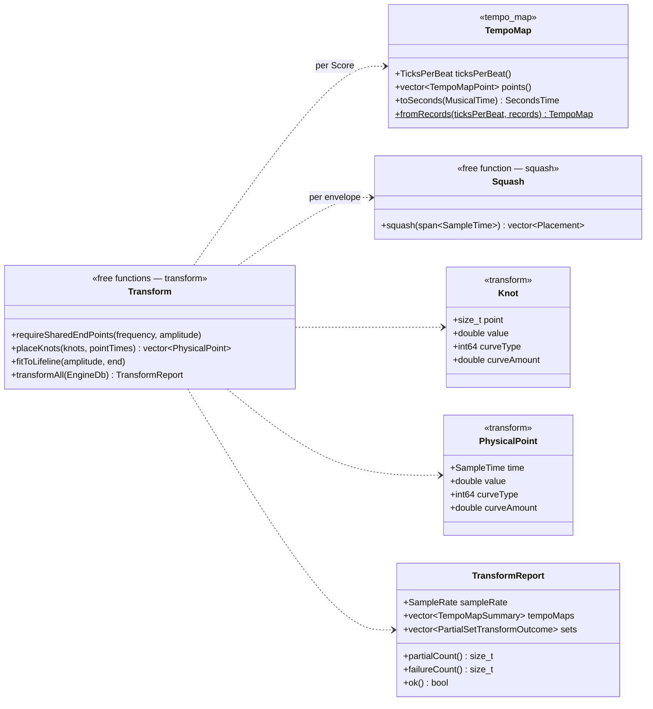

# rendering-engine — transform design

**Status:** implemented, for the first version (§2), designed and built on
2026-10-02. The code is
[transform/musical_units.hpp](../include/rainbohz/rendering_engine/transform/musical_units.hpp),
[transform/tempo_map.hpp](../include/rainbohz/rendering_engine/transform/tempo_map.hpp),
[transform/squash.hpp](../include/rainbohz/rendering_engine/transform/squash.hpp),
[transform/transform.hpp](../include/rainbohz/rendering_engine/transform/transform.hpp)
and the matching sources under [src/transform/](../src/transform/).

This document designs responsibility 3 of [design.md](design.md) §1 —
"transform the canonical model into the rendering model, in place" — for the
first version of the engine. It operates on `engine-db` as declared in
[engine-schema.cypher](../../engine-db/schema/engine-schema.cypher), and it is
the only part of the engine that reads musical time.

---

## 1. Purpose

The canonical model is what a composer means: a score in **musical time**,
on a tempo map, in Hertz and decibels. The rendering model is what the engine
computes from: **physical time** in samples, radians per sample, one timeline
per partial per parameter ([ADR 0012](../../docs/adr/0012-distinguish-musical-and-physical-time.md)).
Both live in `engine-db`. The transform is the step between them. It reads the
canonical tables, converts, and writes the rendering tables, so that
precomputation ([precomputation.md](precomputation.md)) and rendering
([rendering.md](rendering.md)) never see a tick, a tempo or a Hertz.

Two things make the step more than a change of units:

- **Time is squashed, not just scaled.** A musical point carries a physical
  offset in seconds (a percussive attack has the same length at any tempo),
  so after conversion points can land out of order or before time zero. The
  user's order of states is kept and time yields (§6.3,
  [ADR 0014](../../docs/adr/0014-resolve-time-collisions-by-semantic-order.md)).
- **Partials come apart.** A canonical timeline belongs to a partial set and
  states several partials at once, each property optional. The rendering
  model wants one list per partial per property. Each partial's envelope for
  each property is assembled from the points where that property has a value
  (§6.2).

## 2. Scope of this version

| In this version | Not yet |
| --- | --- |
| One `TempoMap` per `Score`, reached by `Score → NEXT_POINT → TempoMap` | Several tempo maps and `TEMPO_MAP_SYNCHRONIZATION_POINT`; any such edge is refused |
| Held tempi and ramps linear in musical position ([ADR 0013](../../docs/adr/0013-tempo-ramps-are-linear-in-musical-position.md)) | Other ramp shapes |
| `PartialSetMusicalTimeline` → one `FrequencyPhysicalTimeline` and one `AmplitudePhysicalTimeline` per partial | Phase (`PartialState.phase`, `phase_lock`, `PhasePhysicalTimeline`): read for nothing, written nowhere |
| `POINT_AT.sync_point` and `offset_seconds`, with the squash rule | Overlapping or cross-fading colliding states (§14) |
| Curve type and amount copied through per property | Interpreting curves; precomputation accepts linear only |
| Rebuild on every run | Dirty flags and incremental transformation |
| | `SpatialPositionMusicalTimeline` and the modulator timelines |

Everything in the right-hand column is anticipated by the structure in §6,
but none of it is implemented, and none of it is validated against: a score
that contains, for example, a `PartialState.phase` is transformed as though
it were NULL.

## 3. Units and types

The transform meets both unit systems of the schema header: the canonical
units coming in, the rendering units going out. Each quantity has a unit type
(AGENTS.md, C++ Conventions), and the musical ones exist only inside the
namespace `rainbohz::rendering_engine::transform`.

| Quantity | Unit | C++ type | Representation | Type in `engine-db` |
| --- | --- | --- | --- | --- |
| Musical position | ticks of one `TempoMap` | `MusicalTime` | `int64` | `INT64` (`position`, `sync_point`) |
| Musical length | ticks | `MusicalDuration` | `int64` | difference of two positions |
| Resolution | ticks per beat | `TicksPerBeat` | `int32` | `INT32` |
| Tempo | beats per minute | `Tempo` | `double` | `DOUBLE` |
| Physical time, intermediate | seconds | `SecondsTime` | `double` | not stored |
| Physical offset | seconds | `SecondsDuration` | `double` | `FLOAT` (`offset_seconds`) |
| Physical time, stored | samples, continuous | `SampleTime` | `double` | `DOUBLE` |
| Frequency, in | Hz | `Hertz` | `double` | `FLOAT` |
| Frequency, out | radians per sample | `AngularFrequency` | `double` | `DOUBLE` |
| Amplitude | dB | `Decibels` | `double` | `FLOAT` in, `FLOAT` out |

The conversions, each in one place:

| Operation | Result | Where |
| --- | --- | --- |
| `TempoMap::toSeconds(MusicalTime)` | `SecondsTime` | tempo_map |
| `SecondsTime + SecondsDuration` | `SecondsTime` | adding `offset_seconds` |
| `toSampleTime(SecondsTime, SampleRate)` | `SampleTime` | the one place seconds become samples |
| `toAngular(Hertz, SampleRate)` | `AngularFrequency` | units.hpp, shared with rendering's roll-off |
| `beats(MusicalDuration, TicksPerBeat)` | `double` | the tempo formulas |

`MusicalTime + MusicalTime`, `MusicalTime + SecondsDuration` and
`SecondsTime + SampleDuration` do not compile. A musical value cannot reach a
physical timeline without passing through `toSampleTime`, and that function
is called in exactly one line of `transform.cpp`.

**Seconds are an intermediate.** The schema stores physical time in samples.
Seconds exist because the tempo map and the offset are specified in them; the
transform converts to samples once per point and nothing downstream sees a
second again.

**The FLOAT columns matter.** `offset_seconds`, `PartialState.frequency` and
`PartialState.amplitude` are `FLOAT` in the schema. A value such as 0.8 s is
stored as its nearest float32 and the transform converts *that* value. The
examples use offsets that are exact in float32 (§11); the tests allow for the
rounding where they do not.

## 4. Inputs

Once per run:

- the singleton `EngineConfig`, for `sampleRate`;
- every `Score`, with its `TempoMap` by `NEXT_POINT`, the map's
  `ticks_per_beat` and its `TempoMapPoint`s in `NEXT_POINT` order
  (`position`, `start_tempo`, `hold`);
- the number of `TEMPO_MAP_SYNCHRONIZATION_POINT` edges, which must be zero.

Per `PartialSet` that has a `PartialSetMusicalTimeline` by
`HAS_MUSICAL_TIMELINE`:

- the Score it hangs from, by
  `Score → HAS_SOUNDENTITY → SoundEntity → HAS_SOUNDSOURCE → SoundSource → HAS_PARTIALSET → PartialSet`;
- its partials, by `HAS_PARTIAL`;
- its timeline's `PartialSetMusicalTimelinePoint`s in `NEXT_POINT` order,
  each with its `frequency_curve_type`, `frequency_curve_amount`,
  `amplitude_curve_type` and `amplitude_curve_amount`;
- each point's one `POINT_AT`: the `TempoMap` it leads to, `sync_point` and
  `offset_seconds`;
- each point's states, by
  `POINT_STATE → PartialStateSet ← MEMBER_OF_SET_MANY_ONE ← PartialState → STATE_OF → Partial`:
  the partial, `frequency` and `amplitude`.

And, for every partial of such a set, any `FrequencyPhysicalTimeline` and
`AmplitudePhysicalTimeline` it already has, with their points, to be
replaced.

Everything is read in bulk, with a fixed handful of queries, before anything
is written.

## 5. Outputs

For each partial of each transformed set:

- one `FrequencyPhysicalTimeline`, attached by `HAS_PHYSICAL_TIMELINE`, with
  a chain of `FrequencyPhysicalTimelinePoint`s linked by `NEXT_POINT`: `time`
  in samples, `frequency` in radians per sample, `frequency_curve_type` and
  `frequency_curve_amount` copied from the set point the knot came from;
- one `AmplitudePhysicalTimeline` likewise, with `amplitude` in dB.

The two chains start at the same time and end at the same time, exactly, as
precomputation requires (precomputation.md §7). Partial sets with no musical
timeline, and their partials, are not touched: a score may be written in
physical time directly, as the first two examples are.

The shape, for partial B of the tempo-map example (§11), whose frequency has
two knots and amplitude three:

```mermaid
flowchart LR
    subgraph input ["Input — read"]
        PS["<b>PartialSet</b><br/>name = 'Chord'"]
        T["<b>PartialSetMusicalTimeline</b>"]
        P0["<b>PartialSetMusicalTimelinePoint</b>"]
        P1["<b>PartialSetMusicalTimelinePoint</b>"]
        P2["<b>PartialSetMusicalTimelinePoint</b>"]
        P3["<b>PartialSetMusicalTimelinePoint</b>"]
        TM["<b>TempoMap</b><br/>ticks_per_beat = 960"]
        S0["<b>PartialState</b><br/>frequency = 660<br/>amplitude = -6"]
        S2["<b>PartialState</b><br/>frequency = NULL<br/>amplitude = -24"]
        S3["<b>PartialState</b><br/>frequency = 330<br/>amplitude = -144"]
        PS -- HAS_MUSICAL_TIMELINE --> T
        T -- NEXT_POINT --> P0 -- NEXT_POINT --> P1 -- NEXT_POINT --> P2 -- NEXT_POINT --> P3
        P0 -- "POINT_AT 0" --> TM
        P1 -- "POINT_AT 1920" --> TM
        P2 -- "POINT_AT 3840" --> TM
        P3 -- "POINT_AT 7680" --> TM
        P0 -. POINT_STATE, MEMBER_OF_SET .-> S0
        P2 -. POINT_STATE, MEMBER_OF_SET .-> S2
        P3 -. POINT_STATE, MEMBER_OF_SET .-> S3
    end
    B["<b>Partial</b><br/>name = 'B'"]
    S0 -- STATE_OF --> B
    S2 -- STATE_OF --> B
    S3 -- STATE_OF --> B
    subgraph output ["Output — written"]
        FT["<b>FrequencyPhysicalTimeline</b>"]
        F0["<b>FrequencyPhysicalTimelinePoint</b><br/>time = 0<br/>frequency = 0.0864"]
        F3["<b>FrequencyPhysicalTimelinePoint</b><br/>time = 325084.26<br/>frequency = 0.0432"]
        AT["<b>AmplitudePhysicalTimeline</b>"]
        A0["<b>AmplitudePhysicalTimelinePoint</b><br/>time = 0<br/>amplitude = -6"]
        A2["<b>AmplitudePhysicalTimelinePoint</b><br/>time = 133084.26<br/>amplitude = -24"]
        A3["<b>AmplitudePhysicalTimelinePoint</b><br/>time = 325084.26<br/>amplitude = -144"]
        FT -- NEXT_POINT --> F0 -- NEXT_POINT --> F3
        AT -- NEXT_POINT --> A0 -- NEXT_POINT --> A2 -- NEXT_POINT --> A3
    end
    B -- HAS_PHYSICAL_TIMELINE --> FT
    B -- HAS_PHYSICAL_TIMELINE --> AT
```



Point P1 contributes nothing to B: B has no state there. Point P2
contributes an amplitude knot but no frequency knot.

## 6. Algorithm

### 6.1 The tempo map

A `TempoMap` is a `NEXT_POINT` list of `TempoMapPoint`s with a
`ticks_per_beat`. Each point opens a segment at its `position`, in ticks of
this map from the map's start, at `start_tempo` BPM. With `hold = true` that
tempo holds until the next point; with `hold = false` it ramps to the next
point's tempo. A valid map (confirmed by the author, 2026-10-02):

- has at least one point; a one-point map means "this tempo forever";
- has its first point at position 0, so time zero of the Score is tick 0;
- has strictly increasing positions;
- has every tempo finite and in the schema's [1, 1000] BPM;
- has `hold = true` on its last point: there is no next tempo to ramp to, and
  the tempo simply continues.

**A ramp is linear in musical position** (ADR 0013): the tempo at beat *b*
between points (b₁, T₁) and (b₂, T₂) is `T(b) = T₁ + (T₂ − T₁)·(b − b₁)/(b₂ − b₁)`,
the convention of Logic, Cubase, Pro Tools and Live. The elapsed seconds from
b₁ to *b* are the integral of 60 / T, which has a closed form:

```
Δt(b) = 60 · (b₂ − b₁) · ln(T(b) / T₁) / (T₂ − T₁)      when T₁ ≠ T₂
Δt(b) = 60 · (b − b₁) / T₁                             when T₁ = T₂ (held, or flat)
```

Beats are ticks divided by `ticks_per_beat`. The second form is also the limit
of the first as the ramp flattens, so a ramp between equal tempi is a hold.
This is `secondsThrough()` in `tempo_map.cpp`, the one place a logarithm is
taken.

The `TempoMap` class is built once per Score. Its constructor validates the
rules above and accumulates the seconds at every point, so that
`toSeconds(MusicalTime)` is a binary search for the segment plus one
`secondsThrough()` for the part of it before the position. After the last
point the last tempo holds; the first point is at 0, so every non-negative
position is in some segment.

### 6.2 Knots and envelopes

A `PartialSetMusicalTimelinePoint` states, through its `PartialStateSet`, the
values of the set's partials at that point. For one partial and one property,
a value may be:

- **present** — a `PartialState` for the partial exists in the set and the
  property is not NULL: this is a **knot**;
- **absent** — the property is NULL, or the partial has no `PartialState` in
  that set at all. The two are the same thing (author, 2026-10-02): "no knot
  here for this partial and property". The envelope continues from the last
  knot to the next.

So each partial has, per property, an **envelope**: its knots in point order,
each carrying the value and the set point's curve type and amount for that
property, which describe the path from that knot to the next. This is closer
to how a composer thinks than a dense matrix: aligned states at a point are
common, but a partial need not be restated at a point where only its
neighbours change.

Two rules bound the envelopes of one partial:

- **Each property needs at least two knots.** One knot is a lifeline of zero
  length.
- **Both properties share the partial's first and last points.** A partial
  exists from the first point where any of its properties is defined to the
  last. Frequency and amplitude must both be defined at those two points; in
  between they are independent. (An amplitude knot before the first frequency
  knot, or after the last, would have no frequency to sound at.)

The physical time of each set point is computed once per set:

```
τᵢ = toSampleTime(toSeconds(sync_pointᵢ) + offset_secondsᵢ, sampleRate)
```

with a NULL offset read as 0. Every knot on point *i* has computed time τᵢ,
and because frequency and amplitude knots on the same point share one τ, the
two physical timelines start at the same instant without any further rule.

### 6.3 Squash: placing knots in physical time

Along a musical timeline, `sync_point` is non-decreasing (an integrity
constraint, §9). Equal sync points with different offsets are how a
fixed-length attack is written: three points at the same tick, offsets 0, 5
ms and 200 ms. Only the offsets can make physical time go backwards, and they
do whenever such a sound is repeated faster than it lasts. That is valid
input, and the rule for it is this (author, 2026-10-02; ADR 0014):

**The user's order of states is kept. Time yields.** A later point in the
list is a later state, whatever its computed time. When states collide the
later one wins, because a change in zero time between two states would mean
nothing musically or mathematically.

Each envelope is squashed on its own, over its own knots' computed times.
Walking the knots in order with a *tail*, the last placed point, at time T,
and initially a floor at time 0:

1. **In order.** If the knot's time is after T (or, for the first knot, not
   before 0), it is placed at its own time.
2. **Collision.** Otherwise the knot is no later than the tail. Take the run
   of consecutive knots from it that keep stepping backwards, each no later
   than the one before. The last of the run **replaces the tail: its state at
   the tail's time**. The rest of the run, and the old tail, are discarded.
   Earlier placed points are never touched: only the tail yields, however
   early the colliding knot computed.
3. **Compression.** Let *m* be the first later knot whose time is after T.
   The knots between the collapsed run and *m* are mapped linearly from
   `[t_j, t_m]` onto `[T, t_m]`, where `t_j` is the collapsed knot's own
   computed time, so that they keep their proportions in the room that is
   left. If there is no such *m*, nothing is mapped: every remaining knot
   collides in turn, and the envelope ends at T with the last state.
4. Continue from the knot after the run. A compressed stretch can still
   contain a backward step, because the run in step 2 stops at the first
   forward step and a later knot can step back again while still being no
   later than T; the linear map preserves order, so such a step survives it.
   The same rule then applies, which is what the loop does.

Equal times are a collision: the later state wins. Zero is a hard floor: a
first knot before 0 collides with the floor and is placed at 0.

Worked examples, in samples:

| Computed times | Placed (index: time) | What happened |
| --- | --- | --- |
| 0, 10, 20 | 0:0, 1:10, 2:20 | in order |
| −5, 10 | 0:0, 1:10 | floored |
| 0, 100, 50, 200 | 0:0, 2:100, 3:200 | 50 replaces the tail at 100 |
| 0, 100, 60, 40, 200 | 0:0, 3:100, 4:200 | the run 60, 40 collapses to 40 |
| 0, 200, 100, 150, 300 | 0:0, 2:200, 3:225, 4:300 | 150 sat half way from 100 to 300; now half way from 200 to 300 |
| 0, 200, 100, 150, 120, 300 | 0:0, 2:200, 4:225, 5:300 | 120 maps to 210, behind 225, and replaces it |
| 0, 100, 50, 80 | 0:0, 3:100 | no later knot: everything collapses onto the tail |
| 0, 10, 20, 30, 5, 40 | 0:0, 1:10, 2:20, 4:30, 5:40 | 5 is earlier than every point but the first; only the tail yields |
| −50, −20, 100 | 0:0, 1:20, 2:100 | the floor behaves like a tail |

The output is a subsequence of the knots, in order, with strictly increasing
times, none negative; the last knot is always present. An envelope left with
fewer than two points is an error: its lifeline collapsed to an instant.

This is `squash()` in `squash.cpp`, a pure function from times to placements.

### 6.4 The lifeline: fitting amplitude to frequency

Because the two envelopes are squashed separately, a collision at a
partial's last point can delay it in one envelope and not the other. **The
frequency envelope defines the lifeline** (author, 2026-10-02): it is the
hard beginning and end of what can be rendered, and whether the amplitude
makes that a click is the composer's business. So after placement:

- the amplitude envelope's last point is moved to the frequency envelope's
  last time;
- any other amplitude point at or after that time is dropped.

The first points need no rule: both envelopes begin with the same set point
and nothing precedes it, so both are placed at `max(τ, 0)`. The result is
what precomputation.md §7 and rendering.md §9 require: the two lists start
and end together, exactly, because the values come from the same computation.

### 6.5 Units

Frequency knots are converted from Hz to radians per sample with
`toAngular`, after placement. Amplitude stays in dB. Curve type and amount
are copied, not interpreted: a curve type other than linear is valid data
here and precomputation's business to refuse (precomputation.md §7).

### 6.6 The run

1. Read `EngineConfig.sampleRate`. Not exactly one config, or an unusable
   rate, is fatal.
2. Read everything of §4. Any `TEMPO_MAP_SYNCHRONIZATION_POINT` edge is
   fatal: this version converts through one map per Score.
3. Build each Score's `TempoMap`. An invalid map is fatal: every set on it
   would fail the same way.
4. For each set with a musical timeline, in `PartialSet.id` order: validate
   the set (§8), compute τ per point, build each member's knots. A set that
   fails is recorded, with none of its partials attempted.
5. For each member, in `Partial.id` order: validate the knots (§8), squash
   each envelope, fit amplitude to the lifeline, convert units, and write
   (§7). A partial that fails is recorded and the run continues.
6. Return the report: the tempo maps found, and per set and per partial what
   happened.

`main.cpp` runs the transform after the state has loaded whole and after
`--validate-db` if asked, and before precomputation. Any failure stops the
run before precomputation, as an integrity violation does: precomputation
would otherwise report the same partials again, for want of their timelines.

## 7. Transactions, rebuild and idempotency

**Rebuild every run.** A transformed partial's existing
`FrequencyPhysicalTimeline` and `AmplitudePhysicalTimeline`, with their
points, are deleted and recreated. `DETACH DELETE` on a point also removes
any `FRAME_ENTRY_PHYSICAL_TIMELINE` edge an earlier precomputation left on it;
precomputation rebuilds its entries in any case. Dirty flags will replace this
(§13).

**Idempotent.** Running the transform twice on the same graph writes the same
points with the same values. Only the `SERIAL` ids differ, so nothing may hold
such an id across a run. This keeps the invariant of design.md §2.

**One transaction per partial.** A partial's two timelines are either both
replaced or both as they were. A set-level failure writes nothing for any of
its partials, since it is detected before any partial is attempted.

## 8. Validation

| Check | Scope | On failure |
| --- | --- | --- |
| Exactly one `EngineConfig`; `sampleRate` non-NULL, positive, fits INT32 | run | run fails |
| No `TEMPO_MAP_SYNCHRONIZATION_POINT` edge | run | run fails: not supported by this version |
| Every Score's `TempoMap` is valid (§6.1): `ticks_per_beat` non-NULL and positive; at least one point; positions, tempi and holds non-NULL; first position 0; positions strictly increasing; tempi finite in [1, 1000]; last point holds; list has no cycle | run | run fails |
| The set has exactly one `PartialSetMusicalTimeline`, with at least one point and no cycle | set | set fails |
| The set is reached from a Score, and that Score has a `TempoMap` | set | set fails |
| Every point has a `POINT_AT`, leading to that Score's `TempoMap`, with `sync_point` non-NULL and ≥ 0, non-decreasing along the list, and `offset_seconds` NULL or finite | set | set fails |
| Every point's four curve fields are non-NULL, types in 0..4, amounts in [0, 1] | set | set fails |
| Every `PartialState` reached from a point is the state of a partial of this set, and no two states at one point are of the same partial | set | set fails |
| Frequency and amplitude each have at least two knots, and share the first and last point (§6.2) | partial | partial fails |
| Every frequency knot is finite; every amplitude knot is finite and in [−144, 0] dB | partial | partial fails |
| After squashing, the frequency envelope has at least two points | partial | partial fails: the lifeline collapsed |

A set-level message names the point by its position in the list and its id;
a partial-level message names the point by its position. Neither names the
set or partial, which the report does.

## 9. Integrity checks

With this feature, `--validate-db` ([integrity.md](integrity.md)) gains the
rules for the columns the transform reads, and the shapes it relies on:

- range rules for `TempoMap.ticks_per_beat`, `TempoMapPoint.position` and
  `start_tempo`, the four curve fields of `PartialSetMusicalTimelinePoint`,
  and `PartialState.frequency` and `amplitude`, both of which may be NULL by
  design;
- `TempoMap` and `PartialSetMusicalTimeline` added to the list checks
  (cycles and merges), with the `FrequencyModulatorPhysicalTimeline` pair that
  the table had been missing;
- the shape of every `TempoMap` (§6.1); every musical point's `POINT_AT`;
  the musical order of every timeline and that it leads to its Score's map;
  and that every `PartialState` has one set and one partial, of the right
  `PartialSet`, at most once per point.

The one-map-per-Score and no-synchronisation rules are limits of this
version, not of the model, so they stay in the transform's own validation
(integrity.md §1).

## 10. Code structure

Four pieces under `transform/`, each depending only on the ones above it,
alongside `units`, `EngineDb` and the existing modules:

1. **`musical_units`** — `MusicalTime`, `MusicalDuration`, `TicksPerBeat`,
   `Tempo`, `beats()`. Header-only. `units.hpp` gains `SecondsTime`,
   `SecondsDuration`, `toSampleTime` and `toSampleDuration`, which are
   physical and may be used anywhere.
2. **`tempo_map`** — `TempoMapPointRecord` (as read), `TempoMapPoint`,
   `secondsThrough()` and the `TempoMap` class. No database dependency.
3. **`squash`** — `Placement` and `squash()`. No dependencies but `units`.
4. **`transform`** — `Knot`, `PhysicalPoint`, the pure stages
   `requireSharedEndPoints()`, `placeKnots()` and `fitToLifeline()`, the
   report types, and `transformAll(EngineDb&)`, the only function that reads
   or writes the database.



**The boundary.** The namespace `rainbohz::rendering_engine::transform` is
where musical time lives. `musical_units.hpp` and `tempo_map.hpp` are
included only from inside it; `main.cpp` includes `transform.hpp` for
`transformAll()` and the report, which carry no musical type. design.md §7
records that the boundary is kept by convention and review; a musical type
appearing in precomputation or rendering is a defect of the same severity as
a wrong phase.

Three exceptions carry the three scopes: `TransformError` (fatal, nothing
written), `PartialSetTransformError` and `PartialTransformError`. Only
`TransformError` escapes `transformAll()`; the others become entries in the
report.

## 11. Worked examples

Both are example scores with JSON mirrors for the oracle
(rendering.md §11.1), whose values were computed by an independent Python
implementation of this document, not by the engine.

**`tempo-map-score.cypher`.** 960 ticks per beat; 120 BPM at tick 0 ramping
to 60 BPM at tick 3840, then held. Beats 0 to 4 take `4 ln 2 = 2.772589 s`;
beat 2 falls at `−4 ln 0.75 = 1.150728 s` (the tempo there is 90); every
beat after 4 takes one second. Points at beats 0, 2, 4 and 8 land at samples
0, 55234.96, 133084.26 and 325084.26. Partial A has four knots of each
property; partial B has frequency at beats 0 and 8 only and amplitude at 0,
4 and 8 (§5 diagram).

**`offset-collision-score.cypher`.** 480 BPM held, so a beat is 0.125 s.
Three hits on beats 0, 1 and 2, each three points at the same tick with
offsets 0, 1/128 s and 3/16 s: quiet, loud, quiet. A hit lasts 0.1875 s but
the next starts 0.125 s later. Computed times in samples, in list order:
0, 375, 9000, 6000, 6375, 15000, 12000, 12375, 21000. Placed: 0, 375,
9000 (hit 2's start, replacing hit 1's end), 9250 (hit 2's peak, compressed:
375 of the 9000 that were left became 250 of the 6000 that are), 15000,
15250, 21000. Seven points of nine survive, and the hits are heard in order,
each cut by the next.

## 12. Numerical precision

Times are `double` samples, as everywhere in the rendering model
(precomputation.md §8). The tempo formulas take one logarithm per segment and
accumulate seconds across at most as many segments as the map has points, so
their error is a few ulp of a value in seconds, far below one sample. The
compression step is one multiply and add per point. The FLOAT columns (§3)
are the only place precision is actually lost, and that happens when the
score is written, not here.

## 13. Future extensions

- **Phase.** `PartialState.phase` (degrees, nullable: "free") and
  `phase_lock` become a `PhasePhysicalTimeline` in radians, once
  precomputation's phase support exists to read it.
- **Spatial position and modulators**, each a musical timeline to convert the
  same way.
- **Several tempo maps**, synchronised by `TEMPO_MAP_SYNCHRONIZATION_POINT`:
  a DAG of maps with relative scaling between synchronisation points, as the
  schema comment sketches.
- **Dirty flags**, so that only the sets whose canonical input changed are
  transformed again.
- **Curves.** When precomputation and rendering interpret curve types, the
  transform still only copies them; nothing here changes.

## 14. Open questions

- **What happens at a collision.** A later state replaces the tail outright,
  so the sound jumps. A short overlap or cross-fade at the collision may be
  wanted later; the author has deferred it (2026-10-02).
- **Non-decreasing versus strictly increasing `sync_point`.** This version
  allows equal sync points, since a fixed-length attack needs them. To be
  confirmed by the author.
- **Where a score ends.** The transform defines each partial's lifeline; the
  score's own end, if it needs one, is not defined anywhere yet.
